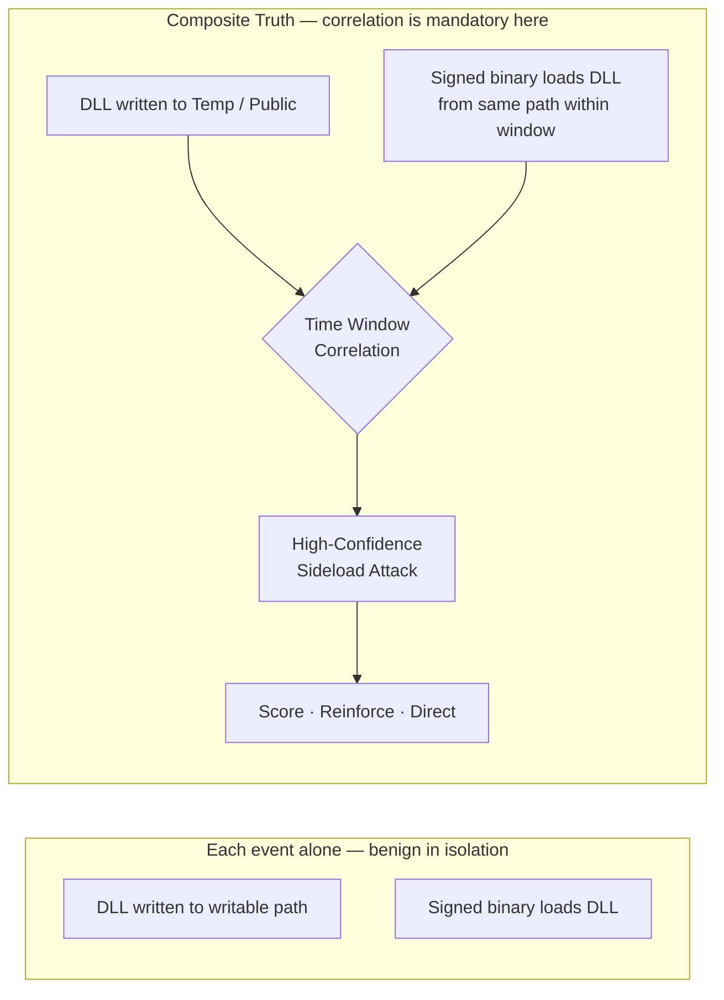
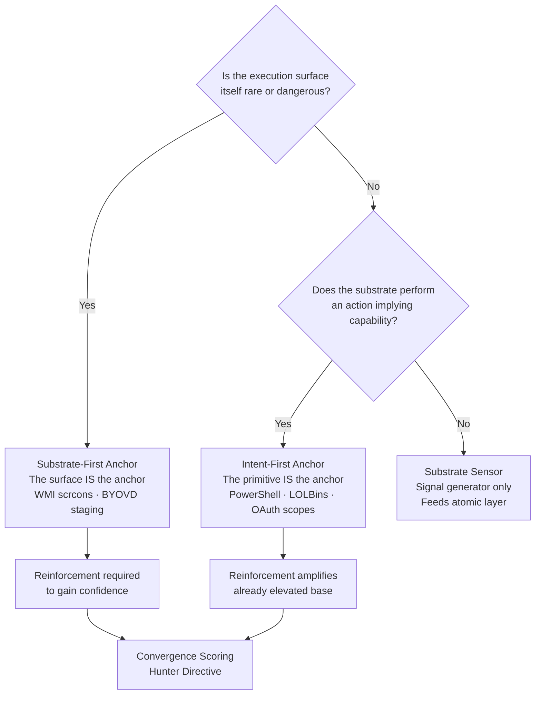
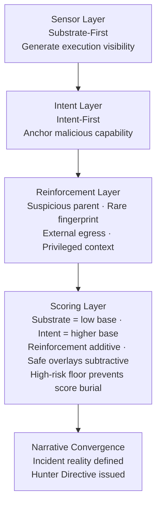
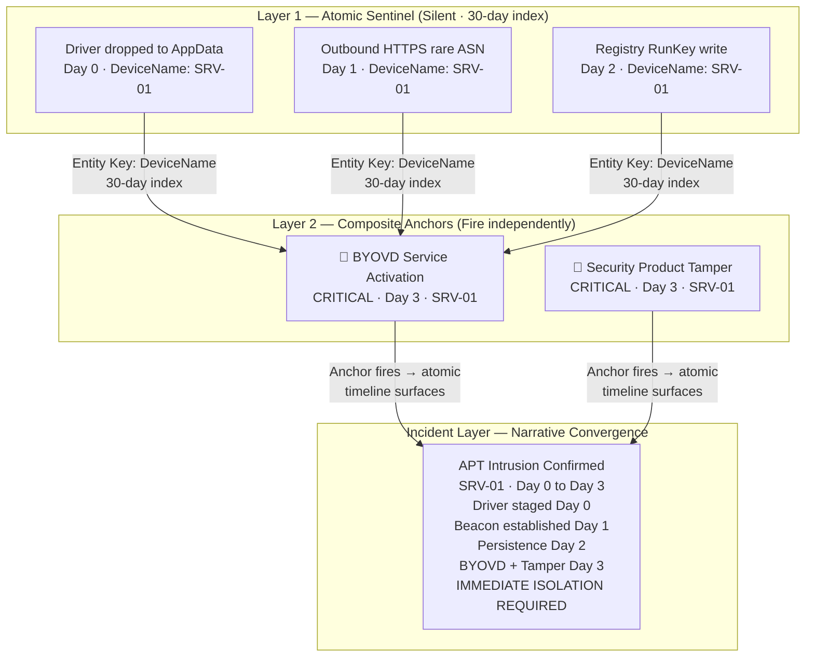
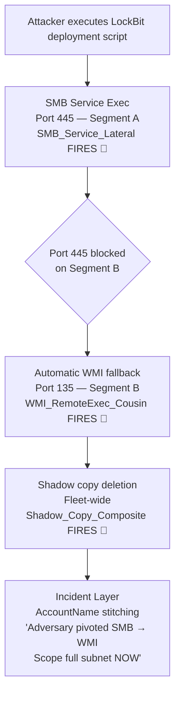
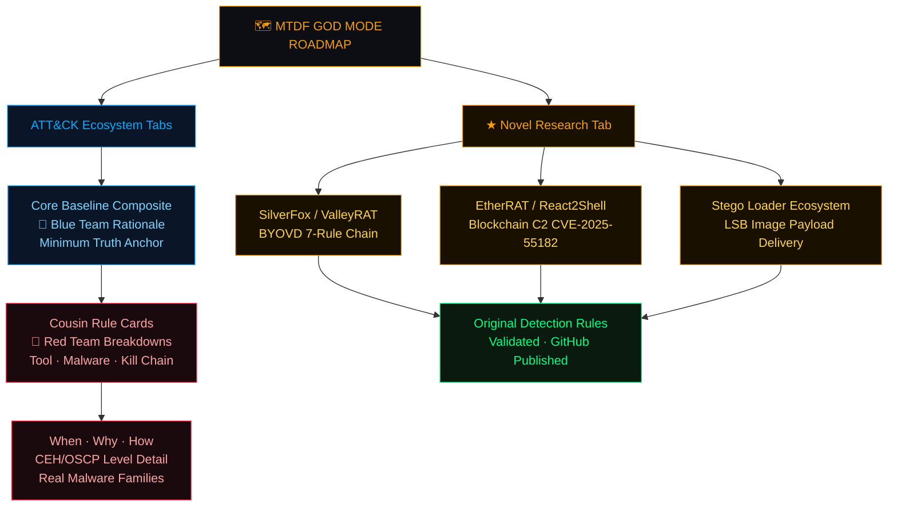
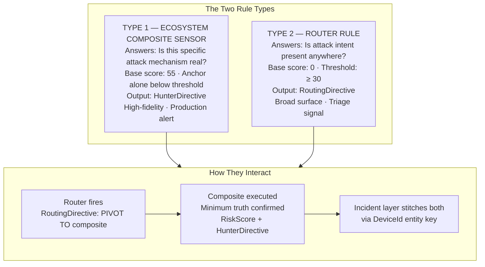
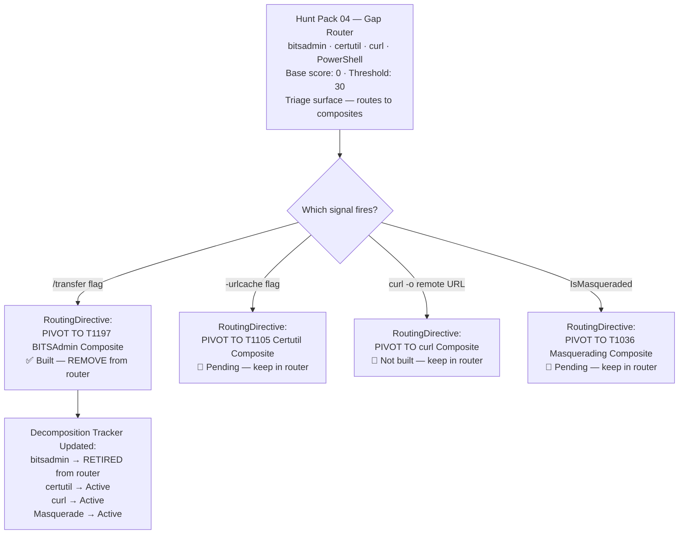
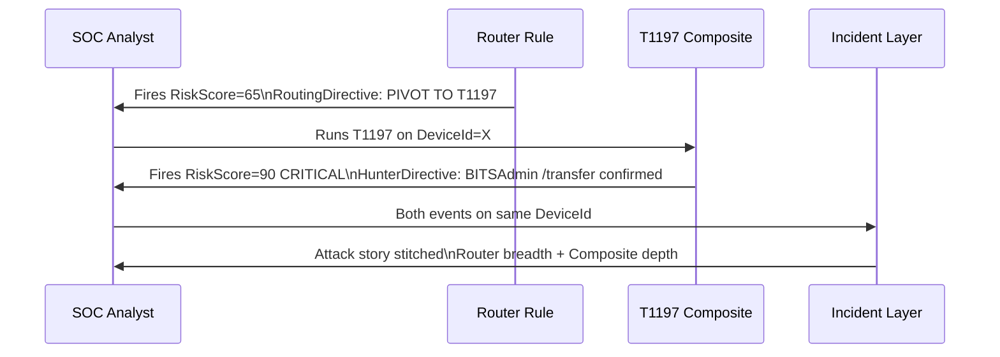

# Minimum Truth Detection Framework
### *Adversary-Informed Detection Engineering from First Principles*

**Author:** Ala Dabat | [github.com/azdabat](https://github.com/azdabat) — a framework and methodology I built myself, from hard-earned trial and error.
**License:** [CC BY-NC-SA 4.0](https://creativecommons.org/licenses/by-nc-sa/4.0/legalcode)
**Validated Against:** ADX-Docker · Empire C2 Telemetry · Atomic Red Team

---

## License — CC BY-NC-SA 4.0

Copyright (c) 2026 Ala Dabat. All Rights Reserved.

This work (including all KQL queries, detection logic, documentation, and the "Minimum Truth" Framework architecture) is licensed under the Creative Commons Attribution-NonCommercial-ShareAlike 4.0 International License.

**You are free to:**
* **Share** — copy and redistribute the material in any medium or format.
* **Adapt** — remix, transform, and build upon the material.

**Under the following terms:**
* **Attribution** — You must give appropriate credit to **Ala Dabat**, provide a link to the license, and indicate if changes were made. You may do so in any reasonable manner, but not in any way that suggests the licensor endorses you or your use.
* **NonCommercial** — You may **NOT** use the material for commercial purposes (e.g., selling these rules, including them in a paid product, or putting them behind a paywall).
* **ShareAlike** — If you remix, transform, or build upon the material, you must distribute your contributions under the same license as the original.

**Full Legal Code:** https://creativecommons.org/licenses/by-nc-sa/4.0/legalcode

---

> *"Start with the minimum truth required for the attack to exist.*
> *Everything else is reinforcement — not dependency.*
> *If the baseline truth is not met, the attack is not real."*

---

```
╔══════════════════════════════════════════════════════════════════════════════╗
║                    MINIMUM TRUTH DETECTION FRAMEWORK                         ║
║                                                                              ║
║    Minimum Truth  ──▶  Reinforcement  ──▶  Scoring  ──▶  Hunter Directive    ║
║                                                                              ║
║    Truth Anchor = Sensor       Reinforcement = Evidence                      ║
║    Cousins = Adjacent Sensors  Incident = Story Stitching                    ║
║                                                                              ║
║    The rule is the sensor. The incident is the narrative.                    ║
╚══════════════════════════════════════════════════════════════════════════════╝
```

---

## Table of Contents

- [Operational Calibration & Testing](#operational-calibration--testing)
- [Engineering Notes — Common Implementation Errors](#engineering-notes--common-implementation-errors)
- [Detection Engineering Lifecycle](#detection-engineering-lifecycle)
- [ATT&CK Substrate Adjacency](#attck-substrate-adjacency)
- [Attack Ecosystem Intelligence — Defeating Temporal Deception](#attack-ecosystem-intelligence--defeating-temporal-deception)
- [Why This Repository Exists](#why-this-repository-exists)
- [Core Philosophy](#core-philosophy)
- [Detection Maturity Model](#detection-maturity-model)
- [Core Doctrine — The Minimum Truth Funnel](#core-doctrine--the-minimum-truth-funnel)
- [Substrate-First vs Intent-First Minimum Truth](#substrate-first-vs-intent-first-minimum-truth)
- [MITRE Ecosystem Coverage — Minimum Truth Anchors & Cousins](#mitre-ecosystem-coverage--minimum-truth-anchors--cousins)
- [OAuth Consent Abuse — Applying Both Anchoring Strategies](#oauth-consent-abuse--applying-both-anchoring-strategies)
- [Noise Model & Suppression Strategy](#noise-model--suppression-strategy)
- [Rarity & Organisational Prevalence](#rarity--organisational-prevalence)
- [Correlation vs Ghost Chains](#correlation-vs-ghost-chains)
- [Primitive Stitching & Incident Narrative Architecture](#primitive-stitching--incident-narrative-architecture)
- [Composite Threat Hunt Portfolio](#composite-threat-hunt-portfolio)
- [Composite Rule Template v1.0](#composite-rule-template-v10)
- [Reference Implementation — Registry Persistence TaskCache](#reference-implementation--registry-persistence-taskcache)
- [Hunter Directives](#hunter-directives)
- [The Rule Factory Checklist](#the-rule-factory-checklist)
- [Architectural Strategy — Split vs Composite](#architectural-strategy--split-vs-composite)
- [Cousin Rules & Attack Ecosystem Coverage](#cousin-rules--attack-ecosystem-coverage)
- [God Mode Composite Roadmap](#god-mode-composite-roadmap)
- [Router Rules — Rules That Sit Outside Ecosystems](#router-rules--rules-that-sit-outside-ecosystems)
- [Production Deployment](#production-deployment)
- [The Attack Ecosystem ATLAS](#the-attack-ecosystem-atlas)

---

## Operational Calibration & Testing

> [!NOTE]
> These detection rules are architected for **logical correctness** and **high-fidelity signal extraction**. Validation was performed in an isolated **ADX-Docker** environment to ensure attack-truth and logic integrity using Empire threat telemetry & Atomic Red Team.
>
> - **Baselines:** Final noise tuning and allow-listing require specific tenant telemetry and administrative context.
> - **Syntax:** Minor syntax variances (e.g., path escaping, column availability) may exist due to the difference between Docker-hosted Kusto and live Cloud schemas. Columns that are not guaranteed in every tenant are wrapped in `column_ifexists()`.

> [!IMPORTANT]
> **Operational Readiness & Integrity**
>
> - **Not "Plug-and-Play":** This is not a copy-paste production repository. Every rule here is considered **untested** unless accompanied by "receipts" — specifically ADX-Docker Empire telemetry results and dedicated documentation.
> - **Engineering vs. Scripting:** This is a record of engineering work, not a basic KQL collection. It represents the iterative process of testing, tuning, and refining logic from scratch.
> - **The Evolution:** While my legacy POC repositories contain the "brittle monoliths" of my early career, this composite section represents the philosophy of true detection engineering.
> - **Originality:** Nothing in this repository is copied; nothing has been borrowed. This documentation is designed to teach a way of thinking.
> - **The Goal:** As anyone who has been in the trenches knows: engineering freedom is only found when architecture becomes simple, reductive, and easy to understand.
>
> **This is Detection-As-Code in its purest form.** *(Fully automated CI/CD pipeline section currently under development)*

---

## Engineering Notes — Common Implementation Errors

During validation of the Minimum Truth Detection Framework composite rule set, several recurring implementation pitfalls were identified while stress-testing multiple KQL detections.

These issues do **not affect the detection doctrine itself** (*Minimum Truth → Reinforcement → Scoring → Hunter Directive*), but arise from common **KQL engineering edge cases**, including:

- Prevalence window overlap
- Incorrect `leftouter` join handling
- SHA256 rarity edge cases
- Non-deterministic `any()` summarization
- Negative composite score behaviour

**[KQL Detection Engineering — Common Implementation Errors](https://github.com/azdabat/Minimum-Truth-Detection-Framework-ADX-Validated-Composite-Rules/blob/main/KQL%20Detection%20Engineering%20%E2%80%94%20Common%20Implementation%20Errors.md)**

This document acts as an engineering reference and lint guide for KQL detection development, capturing the bug classes discovered during composite rule validation. Its purpose is to ensure the framework remains **deterministic, reliable, and production-safe** as additional detection logic is developed.

> The [Reference Implementation](#reference-implementation--registry-persistence-taskcache) in this README carries `[FIX-n]` markers showing exactly where each of these bug classes was corrected in the flagship rule.

---

## Detection Engineering Lifecycle

> [!IMPORTANT]
> This framework is complemented by a dedicated **Detection Engineering Lifecycle model**, which defines how composite detections are **validated, tuned, scored, and governed in real SOC environments**.
>
> While the core doctrine establishes *how detections should be architected*, this lifecycle formalises **how they survive production reality** — including telemetry constraints, noise modelling, performance trade-offs, and continuous refinement.
>
> It captures the transition from **theoretical correctness → operational reliability**, ensuring every rule is not only logically sound, but **measurably effective and SOC-safe over time**.
>
> **Read the full lifecycle model here:**
> https://github.com/azdabat/Minimum-Truth-Detection-Framework-ADX-Validated-Composite-Rules/blob/main/Detection_Engineering_Lifecycle.md

---

## ATT&CK Substrate Adjacency

**[ATT&CK Substrate Adjacency — Detection Coverage Beyond Technique Taxonomy](https://github.com/azdabat/Minimum-Truth-Detection-Framework-ADX-Validated-Composite-Rules/blob/main/ATT%26CK_Substrate_Adjacency.md)**

MITRE ATT&CK provides a taxonomy of adversary techniques, describing **what attackers do** during an intrusion. However, ATT&CK primarily models techniques as independent units with vertical depth (technique → sub-technique). What it does not model is **substrate adjacency** — the reality that many ATT&CK techniques represent the same adversary intent executed across different operating system substrates.

For example, lateral movement via **SMB (T1021.002)**, **DCOM (T1021.003)**, **WinRM (T1021.006)** and **WMI (T1047)** is often operationally interchangeable. An adversary pivots dynamically between them depending on firewall restrictions, privileges, or endpoint controls. Treating these techniques as independent creates a **false sense of detection coverage**.

ATT&CK itself conceded the point in v17, when DLL Side-Loading (T1574.002) was revoked and merged into T1574.001 (now simply "DLL") because the two sub-techniques described overlapping scope — the same substrate, catalogued twice.

The Minimum Truth Detection Framework introduces a **Cousin Technique Doctrine** — modelling adjacent techniques as part of a shared attack ecosystem. This layer sits on top of ATT&CK and enables detection strategies that target **adversary intent** rather than isolated technique identifiers.

---

## Attack Ecosystem Intelligence — Defeating Temporal Deception

Modern adversary tradecraft relies heavily on **Temporal Deception** — staggered C2 jitter, delayed BYOVD kernel exploitation, and automated script loops that pivot dynamically across parallel execution boundaries (Cousin Techniques).

When defensive units rely on traditional, out-of-the-box vendor rules built around monolithic, join-dependent kill chains, they face catastrophic query timeouts or miss intrusions entirely due to sequence fracturing over time.

This framework formalises a **hybrid architecture**: deploying optimised, single-surface Behavioural Composites to deliver immediate high-confidence alerts (*Hunter Directives*), while concurrently running a silent Incident-Layer Stitching Engine mapped to common entity keys (`DeviceName`, `AccountName`).

By separating the sensor architecture from chronological storytelling, this framework achieves true scale-safe efficiency — forcing immediate narrative convergence the exact second an attacker touches an un-bypassable telemetric substrate choke point.

> [!NOTE]
> **Operational Architecture Reference**
>
> For the complete engineering breakdown of this hybrid strategy, behavioural convergence modelling, and specific mitigation protocols against staggered tactics, refer to:
>
> 👉 **[Attack Ecosystem Intelligence Blueprints](https://github.com/azdabat/Minimum-Truth-Detection-Framework-ADX-Validated-Composite-Rules/blob/main/Attack%20Ecosystem%20Intelligence.md)**

---

## Why This Repository Exists

Most SOCs struggle with threat hunting not because they lack tools, but because:

- Detections are **over-engineered** — monolithic queries that collapse under production load
- Behavioural chains are **forced where they are not required** — ghost chains producing false certainty
- Analysts are overwhelmed by **noise disguised as intelligence**
- Rules are written without regard for **SOC operating reality**

This repository documents a **deliberate, operationally grounded methodology** for threat hunting that:

- Scales to real SOC teams under real enterprise load
- Preserves signal fidelity without brittle allowlists
- Reduces analyst fatigue through contextual scoring
- Applies behavioural correlation **only when the attack structurally requires it**
- Remains adversary-informed, not tool-dependent

**Focus:** Practical, adversary-informed threat hunting for real SOC environments
**Audience:** L2 / L2.5 Threat Hunters, Detection Engineers, Security Leads

---

## Core Philosophy

> **Start with the minimum truth required for the attack to exist.**
> Everything else is reinforcement — not dependency.
>
> If the baseline truth is not met, the attack **is not real**.
>
> **Minimum Truth is necessary — but never sufficient.**

The minimum truth decides whether a detection may exist. It does not decide whether an alert fires. Truth alone is usually observable in benign operations — so truth is the starting point, reinforcement builds confidence, and convergence decides severity.

---

## Detection Maturity Model

### 1. Reductive Baseline — Truth First

Every attack technique has a **minimum condition that must be true**. If that condition is not met, the detection should not exist.

| Technique | Minimum Truth Requirement |
|-----------|--------------------------|
| LSASS credential theft | LSASS must be accessed by a process |
| Kerberoasting | Service tickets must be requested using weak encryption |
| OAuth abuse | A cloud app must be granted high-risk permission scopes |
| WMI persistence | `scrcons.exe` must load a script engine DLL |
| DLL sideloading | A signed binary must load a DLL from a writable path |
| Shadow copy deletion | `vssadmin` or `wmic` must invoke delete on shadow copies |

This prevents speculative or assumption-driven hunting.

### 2. Composite L2 / L2.5 Hunts (Default)

Most attacks do **not** require full behavioural chains. This repository focuses on Composite Hunts that:

- Group **related high-signal indicators** around a single truth anchor
- Prefer **single telemetry sources** where possible
- Use minimal joins only when unavoidable

This is where **most effective threat hunting lives**.

### 3. Reinforcement — Confidence, Not Dependency

Once baseline truth is met, confidence is increased using parent/child execution context, suspicious paths or arguments, network proximity, and rarity/prevalence.

Reinforcement improves fidelity. Reinforcement reduces noise. **Reinforcement never defines the attack.**

### 4. Behavioural Chains — Used Sparingly

Correlation is used **only when the attack cannot exist without multiple linked events**. DLL sideloading is the canonical example — a DLL drop alone is benign; a DLL load alone is benign. The attack is only true when **both occur together**, correlated within a time window.



---

## Core Doctrine — The Minimum Truth Funnel

### The Problem at Enterprise Scale

In environments of 100,000+ endpoints, traditional detection fails at the database layer. Standard SIEM rules rely on monolithic queries — massive, multi-table `join` operations executed across raw telemetry — producing query timeouts, extreme compute costs, and what this framework defines as **Bleak Outcomes**: high-confidence intrusions missed entirely because the query never completed.

```
Traditional monolithic rule:
  Stage A  AND  Stage B within 15 minutes  AND  Stage C on same host
  → 100k endpoints → DeviceProcessEvents 500M+ rows/day
  → Cross-table join on raw data → TIMEOUT
  → Attacker delays Stage B by 72 hours → TIME WINDOW MISSED
  → Attacker pivots from SMB to WMI → JOIN CONDITION BROKEN
  → Detection: NULL
```

### The Three Pillars

**Filter Before You Join.** Never join two raw tables. Reduce the primary table to its most critical subset — the truth — before asking for context. This applies to the context table too: the prevalence table is computed only for the entities that survived the truth filter.

**Native Enrichment Over Joins.** Modern EDR schemas carry implicit context. `DeviceRegistryEvents` already contains `InitiatingProcessFileName`, `InitiatingProcessSHA256`, `InitiatingProcessCommandLine`, and `InitiatingProcessVersionInfoCompanyName`. Mapping these native fields eliminates the `DeviceProcessEvents` join entirely — zero memory pressure, full process context.

**Contextual Scoring, Not Binary Alerts.** Once truth is established, route surviving data through a convergence matrix. A cumulative risk score prevents dangerous truths from being suppressed when a safe signal is present, and prevents noise from being elevated when a dangerous signal is absent.

```
BaseScore (Truth Anchor)      =  55   ← never crosses the alert threshold on its own
+ TaskCache class bonus       = +25   ← applies only once a reinforcement exists
+ Dangerous Primitive         = +25
+ Base64 Payload              = +20
+ User-Writable Path          = +15
+ Untrusted Writer            = +10
+ Rare Writer (Prevalence)    = +10
──────────────────────────────────────
FinalScore                    = 160  →  CRITICAL
```

---

## Substrate-First vs Intent-First Minimum Truth

### Why This Distinction Matters

The **Minimum Truth** defines the non-negotiable event that must exist for malicious behaviour to be possible. There are two valid anchoring strategies:

- **Substrate-First Minimum Truth**
- **Intent-First Minimum Truth**

Separating these explicitly completes the framework and prevents over-broad noisy rules, over-fitted brittle intent assumptions, and confusion between observability and attacker intent. Choosing the wrong strategy is a primary cause of detection failure at scale.

PowerShell is the reference substrate used to define both.

### Substrate-First — Definition

A detection anchored on the **execution substrate itself**, without requiring proof of malicious intent at the minimum truth layer.

It answers: *"Did the execution surface exist?"*

```kql
// Substrate-First — PowerShell
// Minimum Truth: PowerShell execution occurred.
DeviceProcessEvents
| where FileName in~ ("powershell.exe", "pwsh.exe")
// That is the substrate. Nothing more.
```

**Characteristics**

- High observability
- Broad coverage
- Requires reinforcement to gain confidence
- Suitable for L1 / atomic sensor logic
- Ideal for correlation-driven architectures
- WMI fileless execution is the prime example of when substrate-first is the *requirement* (see [Rare Surfaces](#when-the-substrate-is-the-anchor--rare-surfaces) below)

**Reinforcement examples (required for confidence):**

```kql
// Suspicious parent relationship
| where InitiatingProcessFileName in~ ("winword.exe","excel.exe","outlook.exe","wscript.exe","cscript.exe")
```

```kql
// External egress shortly after execution
DeviceNetworkEvents
| where InitiatingProcessFileName in~ ("powershell.exe","pwsh.exe")
| where RemoteIPType == "Public"
```

> **Substrate-first truths over a common surface are not alerts. They are signal generators.**

### Intent-First — Definition

A detection anchored on a **malicious execution primitive**, not just the substrate.

It answers: *"Did this substrate perform an action that implies attacker capability?"*

```kql
// Intent-First — PowerShell
// Minimum Truth: PowerShell executed a high-risk primitive.
DeviceProcessEvents
| where FileName in~ ("powershell.exe", "pwsh.exe")
| where ProcessCommandLine has_any (
    "Invoke-WebRequest", "DownloadString",   // Remote retrieval
    "FromBase64String", "IEX",               // Payload decoding + in-memory exec
    "Add-Type", "-EncodedCommand",           // .NET loading + obfuscated exec
    "VirtualAlloc", "OpenProcess"            // Memory allocation / injection primitives
)
```

Here, execution alone is not sufficient. **The primitive implies capability.**

PowerShell execution is common. PowerShell performing in-memory execution, payload decoding, remote retrieval, or memory allocation is not common in normal enterprise workflows. Intent-first anchoring raises base confidence before any reinforcement is applied.

### Comparative Model

| Feature | Substrate-First | Intent-First |
|---------|-----------------|--------------|
| Anchor | Execution surface | Malicious primitive |
| Question | Did the execution surface exist? | Was attacker capability created? |
| Noise | Higher | Lower |
| Reinforcement dependency | High | Moderate |
| Coverage | Broad | Focused |
| Tier suitability | L1 / Sensor | L2 / Composite |
| Use when | No attacker-controlled intent is visible at the telemetry layer (WMI fileless, BYOVD staging) | The substrate is common but the primitive implies capability (PowerShell, LOLBins, OAuth scopes) |

### When the Substrate Is the Anchor — Rare Surfaces

Over a common surface, substrate-first is a sensor feed. It becomes an **alertable composite anchor** in one situation only: when the execution surface is itself rare or structurally dangerous, *and* there is no attacker-controlled intent visible to anchor on instead.

```text
Ask: Is the execution surface itself rare or dangerous enough to anchor on?
  YES → Substrate-First anchor   (WMI scrcons, BYOVD .sys drop)
        Alertable once reinforced.
  NO  → Does this substrate perform an action that implies capability?
    YES → Intent-First anchor    (PowerShell -enc, certutil -decode, mshta http:)
    NO  → Substrate sensor only  — feeds the atomic layer, never alerts alone
```



#### Prime Case — WMI Fileless Execution (T1546.003)

In a WMI Permanent Event Subscription attack using an `ActiveScriptEventConsumer`, the WMI scripting consumer host (`scrcons.exe`) loads a script engine DLL — `vbscript.dll`, `jscript.dll`, or `scrobj.dll` — directly into process memory when the subscription fires.

**There is no child process. No command-line argument. No file written to disk.**

The payload executes as a DLL loaded into a trusted Windows process. Attempting to anchor on intent fails here — there is no attacker-controlled command line visible at the DLL load layer. The substrate IS the signal, and `scrcons.exe` is rare enough in enterprise estates for that substrate to be an anchor.

```kql
// Minimum Truth — WMI Fileless Execution (T1546.003)
DeviceImageLoadEvents
| where InitiatingProcessFileName =~ "scrcons.exe"
| where FileName in~ ("vbscript.dll", "jscript.dll", "scrobj.dll")
// This is the irreducible minimum. You cannot go further left in the kill chain.
```

Reinforcement adds confidence after truth is confirmed:

```kql
// R1: Near-time network egress from scrcons.exe → C2 beacon signal
DeviceNetworkEvents
| where InitiatingProcessFileName =~ "scrcons.exe"
| where RemoteIPType == "Public" and RemotePort in (80, 443)

// R2: DLL loaded from non-system path → staging artefact
// R3: First-time behaviour on this device in 30 days → prevalence anomaly
```

> This anchor covers `ActiveScriptEventConsumer`. A `CommandLineEventConsumer` executes through `WmiPrvSE.exe` as a child process — a different substrate, and therefore a separate cousin sensor.

> **Substrate first. Reinforcement second. Always.**

#### Temporal Case — BYOVD Driver Staging (T1543.003 / T1068)

Most BYOVD deployments (ransomware EDR-killers) drop, register and load the vulnerable driver within seconds. Patient operators, however, can deliberately split staging from activation: a `.sys` driver dropped quietly on Day 0, the service created days later. In that staged variant, the driver drop is the only observable primitive when it occurs — no execution, no intent visible.

```kql
// Minimum Truth — BYOVD Driver Staging (T1543.003 / T1068)
DeviceFileEvents
| where FileName endswith ".sys"
| where FolderPath matches regex @"(?i)\\(AppData|Temp|Public|ProgramData|Users)\\"
// Schema guard: signature status is not exposed on every table/tenant.
// If absent, this degrades to the broader substrate (any .sys to a writable path),
// which is still a valid substrate-first sensor.
| extend WriterSigStatus = tostring(column_ifexists("InitiatingProcessSignatureStatus", ""))
| where WriterSigStatus != "Signed"
   or InitiatingProcessFolderPath matches regex @"(?i)\\(AppData|Temp|Public)\\"
// A .sys file dropped to a writable path by an untrusted or anomalously located binary
// is the substrate truth. The driver is passive. The substrate IS the signal.
```

The 30-day atomic primitive index connects the Day 0 staging to the Day 3 activation — defeating temporal deception that no time-windowed composite rule can address alone.

### Layered Composite Model

| Layer | Strategy | Purpose |
|-------|----------|---------|
| **Sensor** | Substrate-First | Generate execution visibility |
| **Intent** | Intent-First | Anchor malicious capability |
| **Reinforcement** | Context | Suspicious parent · rare fingerprint · external egress · privileged context |
| **Scoring** | Convergence | Substrate truth = low base · intent truth = higher base · reinforcement additive · safe overlays subtractive · high-risk floor prevents score burial |
| **Narrative** | Incident layer | Defines incident reality |



> **Substrate enables execution.**
> **Intent reveals capability.**
> **Reinforcement confirms context.**
> **Scoring determines priority.**
> **Narrative convergence defines incident reality.**
>
> Substrate-first truth observes *where* execution occurred. Intent-first truth observes *what* was done with it.
> Both are valid. **The engineer chooses the tier intentionally.**

---

## MITRE Ecosystem Coverage — Minimum Truth Anchors & Cousins

This table maps the core MITRE attack ecosystems to their minimum truth anchors, the anchoring strategy that applies, and the cousin techniques that must be covered to eliminate false coverage gaps. IDs are aligned to current ATT&CK (post-v17).

```mermaid
graph LR
    subgraph MITRE_Ecosystems["Core MITRE Attack Ecosystems"]
        P[Persistence\nT1053 · T1547 · T1543 · T1546]
        LM[Lateral Movement\nT1021 · T1047 · T1570]
        CA[Credential Access\nT1003 · T1558 · T1621]
        EX[Execution\nT1059 · T1218]
        DE[Defense Evasion\nT1562 · T1055 · T1036]
        C2[Command & Control\nT1071 · T1095]
        EF[Exfiltration\nT1041 · T1567 · T1048]
    end
    subgraph Framework["Framework Response"]
        CS[Cousin Sensors\nCovering adjacent substrates]
        MT[Minimum Truth Anchors\nSubstrate-First or Intent-First]
        IL[Incident Layer\nNarrative stitching]
    end
    MITRE_Ecosystems --> MT --> CS --> IL
```



### Persistence Ecosystem

| Technique | Minimum Truth Anchor | Anchoring Strategy | MITRE | Cousin Techniques | Cousin MITRE |
|-----------|---------------------|--------------------|-------|-------------------|--------------|
| Silent TaskCache Persistence | `RegistryValueSet` under `Schedule\TaskCache` | Substrate-First | T1053.005 | CLI `schtasks.exe /create` | T1053.005 |
| Registry Run Key Persistence | `RegistryValueSet` under `\Run` or `\RunOnce` | Intent-First (writable + payload) | T1547.001 | ActiveSetup · AppInit · Winlogon | T1547.014 · T1546.010 · T1547.004 |
| Service Persistence (ImagePath) | `RegistryValueSet` on `ImagePath` in `Services` | Intent-First (path + writer) | T1543.003 | BYOVD Driver Service | T1543.003 · T1068 |
| WMI Permanent Subscription | `scrcons.exe` loads script engine DLL | Substrate-First | T1546.003 | COM Hijacking · IFEO | T1546.015 · T1546.012 |

### Lateral Movement Ecosystem

| Technique | Minimum Truth Anchor | Anchoring Strategy | MITRE | Cousin Techniques | Cousin MITRE |
|-----------|---------------------|--------------------|-------|-------------------|--------------|
| SMB Service Execution | `services.exe` spawning uncommon child binary | Intent-First | T1021.002 · T1569.002 | WMI Remote Exec · WinRM · DCOM | T1047 · T1021.006 · T1021.003 |
| WMI Remote Execution | `WmiPrvSE.exe` spawning cmd/powershell | Substrate-First | T1047 | PsExec · AT Scheduler · Remote Scheduled Task | T1569.002 · T1053.002 · T1053.005 |
| Pass-the-Hash | NTLM network logon (type 3) between workstations, or logon type 9 (`seclogo`) on the source host | Substrate-First | T1550.002 | Pass-the-Ticket · Overpass-the-Hash | T1550.003 · T1550.002 |

### Credential Access Ecosystem

| Technique | Minimum Truth Anchor | Anchoring Strategy | MITRE | Cousin Techniques | Cousin MITRE |
|-----------|---------------------|--------------------|-------|-------------------|--------------|
| LSASS Memory Dump | Non-AV process opens LSASS with ReadProcessMemory rights | Substrate-First | T1003.001 | DCSync Replication · SAM Extract | T1003.006 · T1003.002 |
| DCSync | Non-DC account performs `GetChanges` replication rights request | Substrate-First | T1003.006 | NTDS.dit Volume Shadow Copy extract | T1003.003 |
| Kerberoasting | Unusual volume of TGS requests using RC4 encryption from non-admin | Intent-First | T1558.003 | AS-REP Roasting (no preauth) | T1558.004 |

### Execution Ecosystem

| Technique | Minimum Truth Anchor | Anchoring Strategy | MITRE | Cousin Techniques | Cousin MITRE |
|-----------|---------------------|--------------------|-------|-------------------|--------------|
| PowerShell Abuse | `-enc` / `IEX` / `VirtualAlloc` primitives | Intent-First | T1059.001 | WScript · CScript · mshta execution | T1059.005 · T1218.005 |
| mshta.exe Proxy Exec | `mshta.exe` with `http://` or `vbscript:` argument | Intent-First | T1218.005 | regsvr32 Squiblydoo · rundll32 | T1218.010 · T1218.011 |
| certutil.exe Decode / Download | `certutil.exe -decode` or `-urlcache` invocation | Intent-First | T1140 · T1105 | bitsadmin · curl · PowerShell WebRequest | T1197 · T1105 · T1059.001 |
| DLL Sideloading | Signed binary loads DLL from user-writable path | Substrate-First (correlation required) | T1574.001 | DLL Search Order Hijack · Phantom DLL | T1574.001 |

> **ATT&CK v17 note:** DLL Side-Loading (T1574.002) was revoked and merged into T1574.001, renamed "DLL". Sideloading, search-order and phantom-DLL hijacks now share one sub-technique — they remain separate *sensors* here because their minimum truths differ, not because ATT&CK separates them.

### Defense Evasion Ecosystem

| Technique | Minimum Truth Anchor | Anchoring Strategy | MITRE | Cousin Techniques | Cousin MITRE |
|-----------|---------------------|--------------------|-------|-------------------|--------------|
| Security Product Tamper | `fltmc.exe unload` or `WinDefend` stop primitives | Intent-First | T1562.001 | Exclusion path addition (`Add-MpPreference`) | T1562.001 |
| BYOVD Rootkit Activation | Service created pointing to `.sys` in writable path | Substrate-First | T1068 · T1543.003 | Kernel Callback Modification | T1014 |
| Process Injection | `VirtualAlloc` in PowerShell script block or via LOLBin | Intent-First | T1055 | Process Hollowing · Thread Hijack | T1055.012 · T1055.003 |

### Command & Control Ecosystem

| Technique | Minimum Truth Anchor | Anchoring Strategy | MITRE | Cousin Techniques | Cousin MITRE |
|-----------|---------------------|--------------------|-------|-------------------|--------------|
| Named Pipe C2 | Pipe creation matching known implant naming pattern | Intent-First (signature-grade — pipe names are operator-configurable; pair with a behavioural cousin) | T1071 | HTTP/S Beaconing to rare ASN | T1071.001 |
| Encrypted C2 (HTTPS Jitter) | Low-volume outbound HTTPS to first-seen domain by LOLBin | Intent-First | T1071.001 | DNS Tunnelling · ICMP C2 | T1071.004 · T1095 |

### Exfiltration Ecosystem

| Technique | Minimum Truth Anchor | Anchoring Strategy | MITRE | Cousin Techniques | Cousin MITRE |
|-----------|---------------------|--------------------|-------|-------------------|--------------|
| LOLBin Exfiltration | `bitsadmin /upload` or `curl` upload (`-T` / `-F`) to external host | Intent-First | T1197 · T1048 | PowerShell `Invoke-WebRequest` / `Invoke-RestMethod` POST | T1059.001 |
| Cloud Storage Exfil | Sync tooling (`rclone`, `MEGAcmd`) transferring to external cloud storage | Intent-First | T1567.002 | Archive staging (`7z`/`rar`) · Bulk SharePoint/OneDrive download spike vs user baseline | T1560.001 · T1530 |

> `certutil -urlcache` is a download primitive (T1105) — it belongs to Ingress Tool Transfer, not exfiltration.

---

## OAuth Consent Abuse — Applying Both Anchoring Strategies

PowerShell clarified the substrate/intent distinction. OAuth makes it operationally necessary.

Unlike endpoint execution, OAuth abuse is identity-driven and user-mediated. The distinction between substrate-first and intent-first becomes critical here.

### OAuth Substrate-First

A successful consent grant occurred. A trust boundary changed. An application was granted permissions; a new execution surface was created. This does **not** imply malicious intent — it is substrate truth, appropriate for tenant visibility, baseline modelling, and consent velocity anomaly detection.

```kql
AuditLogs
| where OperationName in~ (
    "Consent to application",
    "Add delegated permission grant",
    "Add app role assignment grant to service principal"
)
| where Result =~ "success"
```

### OAuth Intent-First

Intent-first in OAuth is not "consent happened." It is: **high-risk permission capability was granted.**

```kql
let HighRiskScopes = dynamic([
    "Mail.ReadWrite",
    "Directory.ReadWrite.All",
    "AppRoleAssignment.ReadWrite.All",
    "RoleManagement.ReadWrite.Directory",
    "Files.ReadWrite.All",
    "Sites.FullControl.All"
]);
AuditLogs
| where OperationName in~ (
    "Consent to application",
    "Add delegated permission grant",
    "Add app role assignment grant to service principal"
)
| where Result =~ "success"
// The alias is required. Without it, the filter below reads the un-expanded
// array (.newValue on an array resolves to null) and never matches.
| mv-expand Prop = TargetResources[0].modifiedProperties
| where tostring(Prop.newValue) has_any (HighRiskScopes)
```

Now the anchor is capability: mail access, directory modification, role assignment, file read/write. This is attacker intent expressed through a permission grant.

### Why OAuth Must Use Intent Anchoring

Consent events are common, and many are completely legitimate. But high-risk permissions imply data access capability, admin consent implies tenant-wide blast radius, a rare AppId implies anomaly, and a scripted User-Agent implies automation.

Without intent-first anchoring (the specific high-risk scope), the rule requires endless tuning against thousands of legitimate application consent events — it behaves like phishing tuning. **The scope grant is the primitive that implies capability; it is the intent anchor that makes the detection stable.**

### OAuth Composite Integration

```
Sensor Layer  (Substrate-First) →  Visibility · baseline modelling · consent velocity
Intent Layer  (Intent-First)    →  High-risk scope capability granted
Reinforcement                   →  Admin consent (OnBehalfOfAll == true)
                                    Suspicious User-Agent · FirstSeen AppId
                                    Rare AppId in tenant · Privileged user
Scoring                         →  Substrate consent = low base score
                                    High-risk permission = primary weight
                                    Admin consent = escalator
                                    Rarity/newness = anomaly boost
                                    Known-good AppId = discount (never bypass)
                                    High-risk floor prevents score burial
```

> **PowerShell clarified the substrate/intent distinction.**
> **OAuth made it operationally necessary.**
>
> The framework is now internally consistent across: endpoint execution, cloud identity abuse, service persistence, privilege escalation, lateral movement, and exfiltration.

---

## Noise Model & Suppression Strategy

### Core Principle

Noise is not removed through blind exclusions. It is **measured, profiled, and down-scored** through contextual weighting. We do not hardcode trust. We model operational behaviour.

```kql
// ❌ Hard exclusion — creates structural blind spots
| where InitiatingProcessFileName != "ccmexec.exe"

// ✅ Soft-allow scoring model
let Penalty_ManagedLineage = -25;
let Penalty_InternalNet    = -10;
let Penalty_HighBurst      = -20;
```

Management automation reduces risk. It does not eliminate telemetry visibility.

### 1. Empirical Noise Baseline — Pre-Tuning Requirement

Before suppression logic is applied, extract dominant operational patterns:

```kql
DeviceProcessEvents
| where FileName =~ "powershell.exe"
| summarize
    Count   = count(),
    Devices = dcount(DeviceId)
  by InitiatingProcessFileName,
     InitiatingProcessAccountName,
     bin(Timestamp, 1h)
| order by Count desc
```

Identify: dominant parent processes, recurring service accounts, patch-window bursts, common automation command-line fragments, recurring execution paths.

> **Noise suppression begins with measurement — not assumptions.**

### 2. Soft-Allow Scoring (Never Hard Exclusion)

```kql
let Score_EncodedPrimitive = 40;
let Score_SuspiciousParent = 30;
let Score_WritablePath     = 20;
let Score_ExternalNetwork  = 25;
let Score_RareExecution    = 15;

let Penalty_ManagedLineage = -25;  // SCCM, Intune, Tanium lineage
let Penalty_InternalNet    = -10;  // Internal IP egress only
let Penalty_HighBurst      = -20;  // 50+ hosts in 10 minutes
```

Where penalties exist, clamp the final score at zero (`iif(RawScore < 0, 0, RawScore)`) — a negative composite score is a bug class, not a signal.

### 3. Managed Execution Context Modelling

Instead of static allowlists, detect behavioural automation traits:

- SYSTEM or service account execution
- Parent lineage including management agents
- High-volume execution during known patch windows
- Repeated execution across large device groups
- Consistent working directories (agent cache paths)

```kql
DeviceProcessEvents
| where FileName =~ "powershell.exe"
| summarize count() by InitiatingProcessFileName
| order by count_ desc
```

Management parents are not excluded — they are **down-scored**. For tenant portability, use configuration tables rather than hardcoded values:

```kql
let TrustedAutomationParents =
datatable(ProcessName:string)
[
    "ccmexec.exe",
    "intunemanagementextension.exe",
    "taniumclient.exe"
];
```

### 4. Convergence Over Single Indicators

Encoded PowerShell alone is insufficient. Require convergence of:

- Encoded or runtime execution primitive
- Suspicious parent (Office, browser, LOLBin chain)
- User-writable staging path
- External network contact
- Low organisational prevalence

Only convergence elevates severity. Single noisy signals remain low priority.

### 5. Burst Modelling

```kql
DeviceProcessEvents
| where FileName =~ "powershell.exe"
| summarize BurstCount = dcount(DeviceId)
  by bin(Timestamp, 10m)
| order by BurstCount desc
// High volume simultaneous → patch deployment / config push → down-score
// Low volume isolated      → targeted intrusion / lateral staging → escalate
```

Burst patterns reduce score. They do not suppress detection.

### Architectural Summary

| Principle | Implementation |
|-----------|----------------|
| No brittle allowlists | Score reduction instead of exclusion |
| Measure before suppressing | Empirical baseline extraction first |
| Convergence required | Multiple reinforcement layers needed for escalation |
| Prevalence modifies urgency | Never suppresses alerts |
| Burst modelling | Differentiates mass automation from targeted intrusion |
| Config-driven tuning | Avoids hard-coded exclusions across tenants |

> **Detection engineering is not about eliminating noise.**
> **It is about anchoring truth, reinforcing intent, modelling behaviour, scoring convergence, and preserving visibility.**
> **Noise suppression must never create blind spots.**
> **Confidence must emerge from convergence — not exclusion.**

---

## Rarity & Organisational Prevalence

> **Rarity is not a detection trigger. It is a prioritisation and confidence amplifier.**
> **If the minimum truth is not satisfied, rarity is irrelevant.**
> **If the minimum truth is satisfied, rarity decides urgency and scope.**

Many SOCs apply prevalence as a blunt filter — "if it's common, ignore it; if it's rare, alert on it." This framework does not. Prevalence answers one operational question: **how normal is this behaviour in *this* organisation?** The same command can be benign in one environment and catastrophic in another.

### Three Safe Applications

**Command / Behaviour Prevalence** — How many hosts exhibit this exact behaviour?
- 1–2 hosts → likely targeted intrusion → escalate
- 200+ hosts → likely IT automation → deprioritise (never suppress)

**Actor / Parent Context Prevalence** — Who normally performs this action in this environment?
- `rundll32.exe` spawned by `winword.exe` → anomalous execution context
- Service account acting outside its role → privilege anomaly

The binary may be common. The **actor and execution context** may not be. This is where prevalence becomes true reinforcement.

**Burst / Radius Prevalence** — How fast and how widely did this appear?
- Single host → targeted persistence
- Multiple hosts in minutes → lateral movement or automation abuse
- Domain-wide in under 10 minutes → ransomware precursor

### What Prevalence Is NOT Used For

| Wrong | Right |
|-------|-------|
| Rarity as standalone alert trigger | Rarity as reinforcement signal after truth |
| Common = safe | Common = lower urgency, not lower visibility |
| Rare = malicious | Rare = higher priority, not automatic alert |
| Unseen = rare | Unseen, rare and no-hash are three different states |
| Suppress LSASS access on AV hosts | Surface always — score urgency by actor context |

LSASS access, illicit OAuth consent, and silent scheduled-task persistence are always surfaced, regardless of prevalence.

**Example — Prevalence Applied After Truth:**

```kql
// Minimum Truth already established — persistence exists:
RegistryValueData has "powershell" and RegistryValueData has "\\users\\public\\"

// Prevalence reinforcement applied AFTER truth confirmation:
| summarize DeviceCount = dcount(DeviceId) by TaskFingerprint
| extend IsRare = DeviceCount <= 2
// 1 device    → likely intrusion  → CRITICAL urgency
// 300 devices → likely IT script  → MEDIUM urgency
// The detection never disappears. The response priority changes.
```

> **Rarity decides how fast we respond — not whether we respond.**
>
> **Minimum Truth defines the attack. Reinforcement increases confidence. Prevalence scales triage.**

---

## Correlation vs Ghost Chains

> **Correlation is only valid when the attack cannot exist without multiple linked events.**

Correlation is one of the most powerful tools in behavioural detection — and one of the easiest ways to destroy signal quality. Most SOCs do not fail because they lack correlation. They fail because they correlate *everything*. This framework treats correlation as a scalpel, not a net.

### What Is a Ghost Chain?

A ghost chain stitches unrelated events into fake kill-chain certainty. It happens when events are common background noise, time windows are arbitrary, joins are used to "make it look advanced", and the attacker does not actually need all stages.

```kql
// ❌ Ghost chain — forces false narrative
RegistryValueSet
| join NetworkConnection on DeviceId
| join ProcessInjection on DeviceId
| where all within 10 minutes
// Persistence may be set today, executed tomorrow → time window MISSED
// Network traffic is unrelated → FALSE POSITIVE
// Injection never occurs → NULL SCORE on real intrusion
```

The result: high-severity alerts with low analyst trust, broken triage, and real attacks hiding nearby.

### The Correct Architecture — Independent Sensors

```kql
// Sensor 1: Persistence truth
DeviceRegistryEvents
| where RegistryKey has "\\Run"
| where RegistryValueData has "powershell"
// Truth: persistence exists. Reinforce and score it here — do not join it to unrelated stages.

// Sensor 2: In-memory execution truth
DeviceEvents
| where ActionType == "PowerShellScriptBlock"   // validate ActionType against your tenant schema
| where AdditionalFields has "VirtualAlloc"
// Truth: in-memory execution capability is being prepared.

// Sensor 3: Silent task persistence truth
DeviceRegistryEvents
| where RegistryKey has "\\Schedule\\TaskCache"
| where RegistryValueData has "-enc"
// Truth: silent scheduled task persistence exists.
```

**Incident-Level Correlation:** the SIEM correlates same device + same user + same timeframe + multiple truths firing. This builds the attack story correctly — without ghost chains inside individual rules.

> **The detection rule is the sensor. The incident is the narrative.**

### Decision Rule

```
Correlate inside a rule ONLY when:
  → The technique cannot exist without both events
  → Telemetry sources are stable and reliable
  → The join reduces ambiguity, not increases complexity

Split into sibling composites when:
  → The truth surface changes
  → The noise domain changes
  → The attacker method is optional
  → The timing may vary across sessions or days
```

> **Correlation is not sophistication. Correlation is dependency.**
> Use it only when the attack truth structurally requires convergence. Otherwise: detect the truth, reinforce confidence, correlate at the incident layer.

---

## Primitive Stitching & Incident Narrative Architecture

### The Two-Layer Fusion Architecture

```
┌──────────────────────────────────┬────────────────────────────────────────────┐
│  LAYER 1: ATOMIC SENTINEL        │  LAYER 2: BEHAVIOURAL COMPOSITE            │
│  (The Net)                       │  (The Anchor)                              │
├──────────────────────────────────┼────────────────────────────────────────────┤
│  Continuous silent logging       │  High-fidelity minimum truth detection     │
│  No individual alert threshold   │  Fires as Instant Hit Anchor               │
│  30-day rolling entity index     │  Immediate HunterDirective output          │
│  Catches what composites miss    │  Triggers pivot into atomic timeline       │
│  Defeats temporal deception      │  Localised time window (2h–48h)            │
└──────────────────────────────────┴────────────────────────────────────────────┘

When a Composite fires:
  → Analyst receives HunterDirective + RiskScore
  → Atomic layer surfaces full 30-day entity timeline
  → Slow-rolling APT staging artefacts become visible
  → Day 0 BYOVD driver drop connects to Day 3 rootkit activation
```

A composite alone misses slow-staged artefacts — it has no context for what happened before the trigger window. An atomic layer alone is too noisy to act on without an anchor. Together, the composite provides the anchor and the atomic layer provides the story around it.



### Entity Keys — The Stitching Mechanism

| Entity Key | Stitching Context |
|------------|------------------|
| `DeviceName` | Host-level — connects all events to one machine |
| `AccountName` | Identity-level — connects to same actor across hosts |
| `DeviceId` | Hardware-level — tamper-resistant stitching |
| `InitiatingProcessId` | Process-session level — use cautiously (PID reuse) |
| `SHA256` | Artefact-level — connects binary drops across time |
| `RemoteIP / ASN` | Infrastructure-level — C2 attribution across hosts |

### The KQL Primitive Collector

Executed when a composite fires (analyst pivot or SOAR playbook) — reconstructing the full entity timeline. Defender Advanced Hunting retains 30 days; for longer lookbacks, run the collector in Sentinel / ADX.

```kql
// ATOMIC PRIMITIVE COLLECTOR
// Triggered by composite anchor — not an alert, a hunting pivot

let EntityKey_Device = "SRV-01";                              // Injected from composite
let AnchorTime       = datetime(2026-05-20T14:22:00Z);        // Composite fire timestamp
let LookbackWindow   = 30d;
let ForwardWindow    = 2h;

let P_Execution =
    DeviceProcessEvents
    | where Timestamp between ((AnchorTime - LookbackWindow) .. (AnchorTime + ForwardWindow))
    | where DeviceName =~ EntityKey_Device
    | where FileName in~ ("powershell.exe","pwsh.exe","cmd.exe","mshta.exe","rundll32.exe","certutil.exe","regsvr32.exe")
    | project Timestamp, Layer="Execution",
              Event = strcat(FileName, " | ", InitiatingProcessFileName, " | ", ProcessCommandLine),
              MITRE = "T1059/T1218";

let P_Persistence =
    DeviceRegistryEvents
    | where Timestamp between ((AnchorTime - LookbackWindow) .. (AnchorTime + ForwardWindow))
    | where DeviceName =~ EntityKey_Device
    | where RegistryKey has_any (@"\Run",@"\RunOnce",@"Schedule\TaskCache",@"CurrentControlSet\Services")
    | project Timestamp, Layer="Persistence",
              Event = strcat("RegWrite: ", RegistryKey, " → ", RegistryValueData),
              MITRE = "T1547/T1053";

let P_DriverStaging =
    DeviceFileEvents
    | where Timestamp between ((AnchorTime - LookbackWindow) .. (AnchorTime + ForwardWindow))
    | where DeviceName =~ EntityKey_Device
    | where FileName endswith ".sys"
    | where FolderPath matches regex @"(?i)\\(AppData|Temp|Public|ProgramData|Users)\\"
    | project Timestamp, Layer="BYOVD Driver Staging",
              Event = strcat("Drop: ", FolderPath, "\\", FileName, " by: ", InitiatingProcessFileName),
              MITRE = "T1543.003/T1068";

let P_Network =
    DeviceNetworkEvents
    | where Timestamp between ((AnchorTime - LookbackWindow) .. (AnchorTime + ForwardWindow))
    | where DeviceName =~ EntityKey_Device
    | where RemoteIPType == "Public"
    | where InitiatingProcessFileName in~ ("powershell.exe","pwsh.exe","rundll32.exe","mshta.exe")
    | project Timestamp, Layer="Network",
              Event = strcat(InitiatingProcessFileName, " → ", RemoteIP, ":", RemotePort),
              MITRE = "TA0011";

union P_Execution, P_Persistence, P_DriverStaging, P_Network
| order by Timestamp asc
| project Timestamp, Layer, Event, MITRE
```

---

## Composite Threat Hunt Portfolio

### Tier-1 Baseline Pack — Enterprise Mandatory Ecosystems

**Live MITRE Coverage Matrix:** https://azdabat.github.io/Minimum-Truth-Detection-Framework-ADX-Validated-Composite-Rules/MITRE-MATRIX.html

> Always-on coverage. High-value truths. SOC-safe baselines for any regulated enterprise (finance, insurance, gov).

| Ecosystem | Minimum Truth Sensor | Composite Built | Reinforcement Tuned | Atomic Validated | Maturity |
|-----------|----------------------|-----------------|---------------------|------------------|----------|
| **PowerShell Execution & Abuse** | Script execution + encoded/runtime intent | ✅ Yes | ⚠️ Partial | ⚠️ In Progress | MED |
| **Registry Autoruns (Run/RunOnce)** | RegistryValueSet on logon trigger keys | ✅ Yes | ✅ Strong | ✅ Tested | HIGH |
| **Scheduled Tasks (CLI Creation)** | `schtasks.exe /create` process truth | ✅ Yes | ✅ Strong | ✅ Tested | HIGH |
| **Scheduled Tasks (Silent TaskCache)** | TaskCache persistence without schtasks.exe | ✅ Yes | ⚠️ Needs Noise Calibration | ⚠️ In Progress | MED |
| **Service Persistence (ImagePath)** | Service registry ImagePath modification | ⚠️ Partial | ❌ Not Tuned | ❌ Not Yet | LOW |
| **Credential Access (LSASS Surface)** | LSASS access/dump behavioural truth | ✅ Yes | ⚠️ Partial | ⚠️ In Progress | MED |
| **NTDS / SAM Extraction** | Hive/NTDS interaction truth | ✅ Yes | ⚠️ Partial | ❌ Not Yet | MED |
| **LOLBins Proxy Execution Core** | Signed binary misuse surface | ✅ Yes | ⚠️ Needs Baselines | ❌ Not Yet | MED |
| **Cloud Identity Persistence (OAuth Consent)** | High-risk scope grant baseline truth | ✅ Yes | ✅ Strong | ⚠️ Tenant Validation Needed | HIGH |

### Tier-2 Composite Correlation Pack — Senior Threat Hunting Layer

Tier-2 introduces multi-surface joins, prevalence reinforcement, kill-chain convergence, and noise suppression through context. These are SOC-safe composites built on Tier-1 truths.

| Ecosystem | Minimum Truth Anchor | Composite Reinforcement Layer | Status | Maturity |
|-----------|----------------------|-------------------------------|--------|----------|
| **Registry Hijacks (IFEO/COM/AppInit)** | Execution interception registry truth | Writable DLL + rare writer + untrusted signer | ⚠️ Partial | MED |
| **WMI Persistence + Execution** | Subscription + anomalous consumer truth | Parent lineage break + script consumer scoring | ✅ Built | HIGH |
| **Lateral Movement (SMB Service / PsExec)** | Remote service creation truth | File drop + inbound 445 + rare service binary | ⚠️ Partial | MED |
| **Defense Evasion (Signed LOLBin Chains)** | Trusted parent → LOLBin baseline | Injection + ghost module + beacon reinforcement | ⚠️ POC → Composite | MED |
| **Session / Token Misuse (Post-Consent)** | Token replay baseline truth | ASN+UA divergence + weak auth reinforcement | ✅ Built | HIGH |
| **Ingress Tool Transfer** | Writable staging drop truth | Followed by execution + outbound comms | ⚠️ In Progress | MED |
| **Shadow Copy Destruction (Ransomware Prep)** | vssadmin/wmic delete truth | Multi-tool convergence scoring | ❌ Missing | LOW |
| **Archive Staging + Exfil Prep** | 7z/rar bulk staging truth | Large volume + outbound correlation | ❌ Missing | LOW |

### Tier-3 Research & Novel Threat Ecosystems

These are not always-on detections — they are **attack research sensors** for emerging tradecraft and patch-resistant persistence chains.

| Threat Ecosystem | Research Truth Anchor | Status | Notes |
|-----------------|----------------------|--------|-------|
| **React2Shell / IIS Exploit Chains** | Web process → CLR abuse → injection | ✅ Modelled | Requires telemetry hardening |
| **EtherRAT / Blockchain C2** | RPC beaconing + low-prevalence infra | ✅ Documented | Network correlation expansion needed |
| **SilverFox / ValleyRAT BYOVD** | Signed loader → sideload → driver load truth | ⚠️ Advanced Composite | Needs DriverLoadEvent validation |
| **Pulsar RAT Injection + Tasks** | Trusted parent → LOLBin → memory exec | 🟡 Parked POC | Awaiting confirmed ecosystem truth |
| **Kernel Driver Abuse (BYOVD)** | Driver service creation + load event | ⚠️ Partial | High impact, tuning required |
| **Supply Chain Behaviour Modelling** | Signed update → anomaly divergence | ✅ Threat Modelled | Tier-2 rule ownership pending |

---

## Composite Rule Template v1.0

*Minimum Truth → Reinforcement → Convergence*

This is the fixed structure I use for all production-grade behavioural detections. It prevents runaway hunts, keeps rules explainable, and ensures every detection is anchored in a single observable truth.

### 1. Minimum Truth (Baseline Anchor)

Every composite hunt begins with **one non-negotiable behavioural truth** — the one event that *must* exist if the technique is happening.

| Ecosystem | Minimum Truth Anchor |
|-----------|----------------------|
| Scheduled Task Abuse | `svchost.exe (Schedule)` spawning abnormal child |
| Service Lateral Movement | `services.exe` spawning uncommon binary |
| Registry Persistence | `RegistryValueSet` in autorun/hijack keys |
| OAuth Consent Abuse | High-risk scope grant event |
| Named Pipe C2 | Rare pipe creation matching implant family |

**Minimum Truth is necessary — but never sufficient.** By itself, it is often noisy.

### 2. Why Truth Alone Is Noisy

A baseline anchor is usually observable in benign operations: Windows maintenance tasks, installer behaviour, admin activity, software updates, background services.

So **we never alert on truth alone.** Truth is only the starting point.

> **Scoring invariant:** the anchor's base score must never, on its own, reach the rule's alert threshold. Anchor-class bonuses (e.g. "this is a TaskCache write", "this is an ImagePath write") apply only once at least one reinforcement is present. If the anchor alone alerts, the rule is alerting on truth alone.

### 3. Reinforcement (Confidence Builders)

Reinforcement answers: *"What makes this baseline depart from normal?"* These are **secondary signals**, not new anchors.

- Dangerous command-line primitives (`-enc`, `iex`, `rundll32`)
- User-writable execution targets (`AppData`, `Temp`)
- TaskCache registry artefacts
- Inbound SMB before execution
- Rare writer process (Org Prevalence)
- Suspicious parent process (Office → LOLBin)

Reinforcement increases score — it does not redefine truth.

### 4. Convergence (Where Noise Becomes Threat)

A detection becomes high-confidence when **multiple reinforcements intersect within a time window**.

```
Minimum Truth
  + Reinforcement A
  + Reinforcement B
  + Context Window
  = Behavioural Threat
```

Example:

- `svchost.exe (Schedule)` spawns PowerShell
- AND inbound SMB happened within 20 minutes
- AND TaskCache artefacts exist
- → Empire-style lateral movement

That intersection is where malicious behaviour begins.

### 5. Noise Suppression (Do Not Dilute Fidelity)

Noise suppression is not optional. Every rule must account for safe vendor binaries, known update processes, common task/service children, and background OS churn — through scoring, not blind exclusion. Rules should remain quiet, high-fidelity, and behaviour-first.

**If suppression breaks the hunt, the baseline is wrong.**

### 6. Org Prevalence (Rarity Reinforcement)

Org prevalence is a prioritisation multiplier: *"How common is this binary or behaviour across the estate?"*

- Writer SHA seen on 1 host → targeted attack likelihood ↑
- Writer SHA seen on 300 hosts → admin tool likelihood ↑

Prevalence is never truth. It is reinforcement. The prevalence baseline must sit **before** the detection window, and "never seen" must be distinguished from "seen rarely".

### 7. Scoring Model (Cumulative, Not Binary)

- Baseline truth = fixed base score (below the alert threshold)
- Reinforcements add weight
- Rare behaviours add weight
- Safe baselines subtract weight (clamped at zero)

```
BaseScore (Truth)              = 55
TaskCache class bonus (gated)  = +25
Dangerous Primitive            = +25
User-Writable Path             = +15
Rare Writer                    = +10
FinalScore                     = 130 (CRITICAL)
```

This prevents brittle yes/no alerting.

### 8. Hunter Directives (Operational Output)

Every rule ends with: what this means, what to pivot into next, how to scope blast radius, and when to escalate immediately. Rules are not just detections. **They are SOC-ready playbooks.**

---

## Reference Implementation — Registry Persistence TaskCache

The framework's canonical case study. Advanced adversaries bypass `schtasks.exe` monitoring by registering tasks through COM/API, or by manipulating the TaskCache registry directly. Tracking this requires querying `DeviceRegistryEvents` — one of the noisiest tables in any SIEM. A traditional join to find the responsible process would crash the tenant.

**Phase 1 — Establish Minimum Truth (The Funnel).** Restrict the dataset to specific high-value keys immediately. Define Danger and Safe parameters dynamically — never hardcoded.

**Phase 2 — Zero-Join Native Enrichment.** Extract the `InitiatingProcess*` fields natively present in the optimised schema. This eliminates the heavyweight `DeviceProcessEvents` join entirely.

**Phase 3 — The Safe Join (Prevalence Only).** The only join permitted is a pre-summarised join — and the prevalence table is itself filtered to the writers that survived Phase 1. **Small table joined to small table.**

**Phase 4 — Convergence Scoring.** Score the remnant data against a contextual matrix and output with a SOC-ready Hunter Directive. Not a binary alert. A contextual story.

> **Writer attribution caveat.** Legitimate task registration (schtasks, COM, API) and legitimate service installation are written to the registry by OS *brokers* — the Task Scheduler service (`svchost.exe`) and the Service Control Manager (`services.exe`). For those paths, writer-based reinforcement is blind by design and content signals must carry the detection. A write by anything *other* than the broker is direct registry manipulation — a strong reinforcement in its own right (`BrokerBypass`).

```kusto
// ============================================================================
// COMPOSITE HUNT (L3): Registry_Persistence_Background_Service_TaskCache
// Author: Ala Dabat
// Platform: Microsoft Defender XDR / Sentinel Advanced Hunting
// Truth Domain: DeviceRegistryEvents (Optimised Schema)
// Minimum Truth: RegistryValueSet under Services OR Schedule TaskCache (Tree/Tasks)
// MITRE: T1543.003, T1053.005
// Zero-join enrichment · Filter-before-join prevalence · Convergence scoring
//
// [FIX-n] markers map to "KQL Detection Engineering — Common Implementation
// Errors". Validate each fix in ADX-Docker before merging.
// ============================================================================

let lookback       = 14d;
let baselineWindow = 30d;   // [FIX-2] prevalence baseline sits BEFORE the detection window

// --- DYNAMIC LISTS & NOISE SUPPRESSION ---
let TrustedPublishers  = dynamic(["Microsoft Corporation","Microsoft Windows","Google LLC","Mozilla Corporation"]);
let TrustedInitiators  = dynamic(["msiexec.exe","trustedinstaller.exe","sppsvc.exe","intunemanagementextension.exe","updateinstaller.exe"]);

// [FIX-5] OS brokers that write these keys on behalf of legitimate callers.
let TaskBroker    = "svchost.exe";   // Task Scheduler service: writes TaskCache for schtasks / COM / API registration
let ServiceBroker = "services.exe";  // Service Control Manager: writes service keys for CreateService / ChangeServiceConfig

let BackgroundKeys = dynamic([
    @"system\currentcontrolset\services",
    @"software\microsoft\windows nt\currentversion\schedule\taskcache\tree",
    @"software\microsoft\windows nt\currentversion\schedule\taskcache\tasks"
]);

// [FIX-6] Matches bare, quoted, \??\-prefixed and %ENV% forms — ImagePath values are frequently quoted
let UserWritableRx  = @"(?i)((^|[""'\s])(\\\?\?\\)?[a-z]:\\(users|public|programdata|temp|downloads|appdata)\\|%(temp|tmp|appdata|localappdata|public|programdata|userprofile)%)";
let Base64ChunkedRx = @"(?:[A-Za-z0-9+/]{20,}={0,2})(?:\s+[A-Za-z0-9+/]{20,}={0,2})+";
let IPv4Rx          = @"\b(?:(?:25[0-5]|2[0-4]\d|1?\d?\d)\.){3}(?:25[0-5]|2[0-4]\d|1?\d?\d)\b";
let DomainRx        = @"\b([a-z0-9][a-z0-9-]{1,62}\.)+[a-z]{2,}\b";
let UrlRx           = @"https?://[^\s'""<>]+";

let DangerTokens = dynamic([
    "powershell","pwsh","cmd.exe","mshta","rundll32","regsvr32","wscript","cscript",
    "certutil","bitsadmin","curl","-enc","-encodedcommand","frombase64string","http:","https:"
]);

let SafePathAnchors    = dynamic([@"c:\program files",@"c:\program files (x86)",@"c:\windows\system32",@"c:\windows\syswow64"]);
let SafeVendorKeywords = dynamic(["windows update","microsoft","google","edge","mozilla","firefox","onedrive","teams","intel","nvidia","amd","realtek","adobe","citrix"]);
// Validate how your schema renders REG_BINARY values (TaskCache Actions / DynamicInfo):
// hex rendering inflates strlen() and can trip IsLargeBlob on benign task registrations.
let PayloadSizeThreshold = 500;

// --- PHASE 1: ESTABLISHING MINIMUM TRUTH ---
// materialize(): Raw feeds both the candidate-writer list and the enrichment path
let Raw = materialize(
    DeviceRegistryEvents
    | where Timestamp >= ago(lookback)
    | where ActionType == "RegistryValueSet"
    | extend RK  = tolower(tostring(RegistryKey)),
             RVN = tolower(tostring(RegistryValueName)),
             RVD = tolower(tostring(RegistryValueData))
    | where RK has_any (BackgroundKeys)
);

// --- PHASE 2: PRE-SUMMARISED PREVALENCE TABLE (Safe Join Only) ---
// [FIX-1] Filter before you join — prevalence is computed only for writers present in the truth set
// [FIX-3] Prevalence measures where the writer EXECUTED (DeviceProcessEvents), not where a file with
//         that hash was WRITTEN (DeviceFileEvents). OS and long-installed binaries are rarely re-written,
//         so file-write prevalence reports them as "rare". The InitiatingProcessSHA256 branch catches
//         boot-started brokers whose own creation may predate the sensor.
let CandidateWriters =
    Raw
    | where isnotempty(InitiatingProcessSHA256)
    | distinct InitiatingProcessSHA256;
let OrgPrevalence =
    union
        (DeviceProcessEvents
         | where Timestamp between (ago(lookback + baselineWindow) .. ago(lookback))
         | where SHA256 in (CandidateWriters)
         | project PrevSHA = SHA256, DeviceId),
        (DeviceProcessEvents
         | where Timestamp between (ago(lookback + baselineWindow) .. ago(lookback))
         | where InitiatingProcessSHA256 in (CandidateWriters)
         | project PrevSHA = InitiatingProcessSHA256, DeviceId)
    | summarize WriterDeviceCount = dcount(DeviceId) by PrevSHA;

// --- PHASE 2: ZERO-JOIN NATIVE ENRICHMENT + SAFE JOIN ---
let Enriched =
    Raw
    | extend
        WriterFile    = tostring(InitiatingProcessFileName),
        WriterCL      = tostring(InitiatingProcessCommandLine),
        WriterSHA     = tostring(InitiatingProcessSHA256),
        // [FIX-4] Schema guard — signer is not a native DeviceRegistryEvents column in every tenant
        //         (Defender exposes signer data via DeviceFileCertificateInfo). Degrades to "".
        WriterSigner  = tostring(column_ifexists("InitiatingProcessSigner", "")),
        WriterCompany = tostring(InitiatingProcessVersionInfoCompanyName),
        WriterUser    = tostring(InitiatingProcessAccountName)
    | extend
        WriterFileL            = tolower(coalesce(WriterFile, "")),
        WriterCLL              = tolower(coalesce(WriterCL, "")),
        // [FIX-4] case-insensitive publisher match
        WriterTrustedPublisher = toint(WriterCompany in~ (TrustedPublishers) or WriterSigner in~ (TrustedPublishers)),
        WriterTrustedInitiator = toint(WriterFileL in (TrustedInitiators))
    | join kind=leftouter OrgPrevalence on $left.WriterSHA == $right.PrevSHA
    // [FIX-3] Three-state prevalence: unseen is not the same as rare, and no-hash is not rare at all.
    //         coalesce(count, 0) would collapse all three into "rare".
    | extend PrevalenceState = case(
                isempty(WriterSHA),        "NoHash",
                isnull(WriterDeviceCount), "FirstSeen",
                WriterDeviceCount <= 2,    "Rare",
                                           "Common")
    | extend WriterIsRare = toint(PrevalenceState in ("FirstSeen", "Rare"));

// --- PHASE 3: CONVERGENCE SCORING & FILTERING ---
Enriched
| extend
    IsService             = toint(RK has "system\\currentcontrolset\\services"),
    IsTaskCache           = toint(RK has "schedule\\taskcache"),
    ServiceImagePathWrite = toint(RK has "system\\currentcontrolset\\services" and RVN has "imagepath"),
    HasDanger             = toint(RVD has_any (DangerTokens) or WriterCLL has_any (DangerTokens)),
    HasBase64             = toint(RVD matches regex Base64ChunkedRx or WriterCLL matches regex Base64ChunkedRx),
    HasNet                = toint(RVD matches regex UrlRx or RVD matches regex IPv4Rx or RVD matches regex DomainRx),
    PointsWritable        = toint(RVD matches regex UserWritableRx),
    IsLargeBlob           = toint(strlen(RVD) > PayloadSizeThreshold),
    IsSafePath            = toint(RVD has_any (SafePathAnchors)),
    IsSafeVendor          = toint(RVD has_any (SafeVendorKeywords) or RVN has_any (SafeVendorKeywords)),
    UntrustedWriter       = toint(WriterTrustedPublisher == 0)
| extend
    // [FIX-5] Broker bypass — the key was written by something other than its OS broker
    BrokerBypass   = toint((IsTaskCache == 1 and WriterFileL != TaskBroker)
                        or (ServiceImagePathWrite == 1 and WriterFileL != ServiceBroker)),
    ContentSignals = HasDanger + HasBase64 + HasNet + PointsWritable + IsLargeBlob
| extend
    HasReinforcement = toint(ContentSignals + BrokerBypass > 0)
// Enforce Minimum Truth
| where (IsService == 1 or IsTaskCache == 1)
| where (IsTaskCache == 1) or (ServiceImagePathWrite == 1) or (HasDanger == 1) or (PointsWritable == 1) or (IsLargeBlob == 1)
// Enforce Noise Suppression
| where not(IsSafePath == 1 and IsSafeVendor == 1 and ContentSignals == 0)
| where not(WriterTrustedInitiator == 1 and ContentSignals == 0)
// Calculate Risk Score
// [FIX-5] Anchor-class bonuses are gated on reinforcement — the anchor alone (55) never crosses
//         the MEDIUM threshold (70). Previously a bare TaskCache write scored 80 and a bare ImagePath
//         write scored 75: the rule alerted on truth alone, including run-state updates written by
//         the Task Scheduler on every task execution.
| extend
    RiskScore = 55
              + (25 * IsTaskCache * HasReinforcement)
              + (20 * ServiceImagePathWrite * HasReinforcement)
              + (25 * BrokerBypass)
              + (25 * HasDanger)
              + (20 * HasBase64)
              + (10 * HasNet)
              + (15 * PointsWritable)
              + (25 * IsLargeBlob)
              + (10 * UntrustedWriter)
              + (10 * WriterIsRare)
| extend
    RiskLevel = case(RiskScore >= 120, "CRITICAL",
                     RiskScore >= 90,  "HIGH",
                     RiskScore >= 70,  "MEDIUM", "LOW")
// --- PHASE 4: ACTIONABLE OUTPUT ---
| where RiskLevel in ("MEDIUM", "HIGH", "CRITICAL")
// [FIX-7] PowerShell -EncodedCommand is UTF-16LE: strip interleaved nulls after decoding
//         (base64_decode_tostring() is the documented function name)
| extend B64Blob = extract(@"([A-Za-z0-9+/]{40,}={0,2})", 1, tostring(RegistryValueData))
| extend DecodedPayload = iff(isempty(B64Blob), "", replace_regex(base64_decode_tostring(B64Blob), @"\x00", ""))
| extend PersistenceClass = case(IsTaskCache == 1,           "TaskCache(SilentTask)",
                                 ServiceImagePathWrite == 1, "Service(ImagePath)",
                                                             "Background(Other)")
// [FIX-8] Hunter Directive item 2 — show WHAT reinforced confidence, not just the total
| extend ScoreDrivers = bag_pack(
    "BrokerBypass", BrokerBypass, "Danger", HasDanger, "Base64", HasBase64, "Net", HasNet,
    "Writable", PointsWritable, "LargeBlob", IsLargeBlob, "UntrustedWriter", UntrustedWriter,
    "Prevalence", PrevalenceState)
| extend HunterDirective = case(
    BrokerBypass == 1 and IsTaskCache == 1,
        strcat(RiskLevel, ": TaskCache written directly by ", WriterFile, " — not the Task Scheduler service. Registry-level task manipulation (hidden/silent task tradecraft). Pull Tree + Tasks keys, compare against C:\\Windows\\System32\\Tasks, isolate if unauthorised."),
    BrokerBypass == 1 and ServiceImagePathWrite == 1,
        strcat(RiskLevel, ": Service ImagePath written directly by ", WriterFile, " — SCM bypassed. Validate service name, binary path and signer; check for pending reboot activation."),
    RiskLevel == "CRITICAL" and PersistenceClass startswith "TaskCache",
        "CRITICAL: Silent Scheduled Task persistence via TaskCache (API/COM). Pull task definition, isolate if unauthorised.",
    RiskLevel == "CRITICAL" and PersistenceClass startswith "Service",
        "CRITICAL: Service persistence set (ImagePath) with strong indicators. Validate service name + binary path.",
    RiskLevel == "HIGH",
        "HIGH: Background persistence registry artefact. Pivot to writer ancestry.",
        "MEDIUM: Background persistence signal. Validate if approved updater/agent; if not, escalate."
)
| project
    Timestamp, DeviceName, DecodedPayload,
    // [FIX-4] DeviceRegistryEvents has no native AccountName column in Defender
    AccountName = coalesce(WriterUser, tostring(column_ifexists("AccountName", ""))),
    RegistryKey, RegistryValueName, RegistryValueData, PersistenceClass,
    WriterProcess = WriterFile, WriterCommandLine = WriterCL,
    WriterCompany, WriterSigner, WriterSHA, WriterDeviceCount, PrevalenceState,
    ScoreDrivers, RiskScore, RiskLevel, HunterDirective
| order by RiskScore desc, Timestamp desc
```

---

## Hunter Directives

Every composite hunt produces **guidance alongside results — not after**.

Each rule outputs a `HunterDirective` that answers:

1. **Why** this fired — baseline truth confirmed
2. **What** reinforces confidence — scoring context (surfaced as `ScoreDrivers`)
3. **What** to do next — pivot, scope blast radius, escalate

> *HIGH: LSASS accessed by non-AV process using dump-related command line.*
> *Action: Validate tool legitimacy, scope for lateral movement, escalate to L3.*

Hunter Directives are SOC-ready playbooks embedded in the detection output. Rules are not just detections — they are operational response guides.

---

## The Rule Factory Checklist

Before publishing any composite hunt, I confirm:

| Requirement | Check |
|-------------|-------|
| Minimum Truth is 1 clear anchor | ✅ |
| Reinforcement signals are optional (2–4 max) | ✅ |
| Convergence window is defined | ✅ |
| Noise suppression is explicit | ✅ |
| Org prevalence is scoring only — never a hard filter | ✅ |
| Severity is cumulative, not binary | ✅ |
| Output is SOC-actionable with Hunter Directive | ✅ |
| Anchor alone scores below the alert threshold | ✅ |
| Prevalence baseline excludes the detection window; unseen ≠ rare | ✅ |
| Non-guaranteed columns wrapped in `column_ifexists()` | ✅ |

> **The Golden Rule: If I cannot explain the hunt in 60 seconds, it is too complex.**
> **Composite engineering is clarity, not bloat.**

---

## Architectural Strategy — Split vs Composite

> We do not group rules by MITRE Tactic ("all Persistence in one query").
> We group rules by **Attack Surface Ecosystem** — the operational domain where the same kind of truth is observable.

A Composite Rule enforces context around a **single coherent stream of activity** (same mechanism, same telemetry surface, same truth). If the logic must jump across different execution mediums, schemas, or transport mechanisms, the rule is **split** into a sibling hunt.

> **The detection rule is the sensor. The incident/case is the narrative that stitches sensors into an attack story.**

### The Four Rules of Detection Architecture

**Rule 1 — Split when the Minimum Truth changes.**
If the baseline event requires a schema change, telemetry change, or mechanism change — SPLIT.

| Minimum Truth Shift | Decision |
|---------------------|----------|
| Host process execution → Identity log transaction | ✂️ SPLIT |
| API call telemetry → Artefact registry/file telemetry | ✂️ SPLIT |
| SMB/Service lateral movement → WMI/DCOM lateral movement | ✂️ SPLIT |
| DNS protocol telemetry → HTTP protocol telemetry | ✂️ SPLIT |
| Same LOLBin surface, different intent primitives | ✅ KEEP |

**Critical caveat:** split only when the **anchor mechanism** changes. Reinforcement signals may cross telemetry surfaces (process, registry, file, network) as long as they remain optional and do not replace the baseline truth.

```
DO NOT split when reinforcement crosses tables:

  Baseline truth  =  svchost(schedule) spawning suspicious child
  Reinforcement   =  TaskCache registry artefacts    ← optional cross-table evidence
  Reinforcement   =  Task XML drops                  ← optional cross-table evidence
  Reinforcement   =  Org prevalence rarity           ← optional cross-table scoring

The truth anchor remains execution. Registry is supporting evidence, not the trigger.
```

**Rule 2 — Split when the noise domain changes.**
SCCM automation noise vs developer PowerShell vs DC replication are entirely different noise profiles requiring distinct suppression models. SPLIT.

**Rule 3 — Split when the telemetry surface changes.**
`DeviceProcessEvents ≠ DeviceRegistryEvents ≠ SigninLogs ≠ DeviceNetworkEvents`. Different primary tables = different sensors.

**Rule 4 — Keep composite when refining context.**
Classification, scoring, enrichment, and reinforcement belong inside the rule when the Minimum Truth stays the same:
- Same process surface: different LOLBins doing the same intent → KEEP
- Same network surface: different URIs to the same destination category → KEEP
- Same persistence surface: create vs change using the same tool and schema → KEEP

### Decision Matrix — Split vs Keep

| Ecosystem | Scenario | Decision | Reason |
|-----------|----------|----------|--------|
| **Scheduled Tasks** | `schtasks.exe /create` vs `Register-ScheduledTask` | ✂️ SPLIT | Different truth surface: CLI process vs API/script abstraction |
| **Scheduled Tasks** | `schtasks.exe /create` vs `schtasks.exe /change` | ✅ KEEP | Same truth domain: same binary + schema |
| **Scheduled Tasks** | Task creation vs task execution telemetry | ✂️ SPLIT | Creation truth ≠ Execution truth |
| **Lateral Movement** | SMB service exec vs WMI remote process | ✂️ SPLIT | Different mechanism, different noise domain |
| **Credential Access** | LSASS dump vs DCSync vs Kerberoasting | ✂️ SPLIT | Different telemetry surfaces entirely |
| **LOLBin Execution** | rundll32 vs regsvr32 vs mshta (same parent, same intent) | ✅ KEEP | Same process surface, same attacker goal |

### Essential To Remember

```
Truth Anchor  = Sensor
Reinforcement = Evidence
Cousins       = Adjacent sensors
Incident      = Story stitching

Truth defines the rule. Reinforcement strengthens it.
```

---

## Cousin Rules & Attack Ecosystem Coverage

> When a high-fidelity composite is created for one execution surface, its *cousin* is the adjacent surface that shares the same adversary goal but lives in a different **noise domain**.
> Cousin rules are **separate but paired** — they do not mix truth anchors with noisy signals that dilute fidelity.

### Definition

For any given detection composite, a cousin rule is the paired counterpart in the same attacker ecosystem that:

- Represents a **different execution or persistence surface**
- Shares the same **attack intent**
- Requires **stricter noise gating** due to different noise characteristics
- Is structured as a **twin detection module**
- Improves **ecosystem coverage** without breaking rule fidelity

### Why Cousin Rules Are Non-Negotiable

Sophisticated threat actors use cousin attack surfaces as **fallback layers**. Automated deployment toolkits contain cousin-surface fallback logic:



A monolithic rule anchored on SMB service creation scores NULL the moment the attacker pivots to WMI. The cousin composite fires independently. The incident layer stitches both surfaces to the same actor. **The pivot is not a defence. It is a data point.**

### Cousin Ecosystem Discovery — Empirical Validation

This framework is not built on theoretical MITRE grouping — it is built on **empirically discovered cousin ecosystems**, validated through ADX-Docker simulation, Empire-style telemetry, and repeated convergence testing across persistence and execution surfaces.

**Full living discovery journal:**
https://github.com/azdabat/Production-READY-Composite-Threat-Hunting-Rules/blob/main/Cousin_Discovery_Log.md

### Ecosystem Table — Composites + Cousins

**Live Roadmap:** https://azdabat.github.io/Minimum-Truth-Detection-Framework-ADX-Validated-Composite-Rules/MITRE-MATRIX.html

| Ecosystem | Primary Composite | MITRE | Cousin Composite | Cousin MITRE | Notes |
|-----------|------------------|-------|-----------------|--------------|-------|
| **Registry Persistence** | `Registry_Persistence_Background_Service_TaskCache` | T1543.003, T1053.005 | Registry Persistence Alternate Anchors | T1543, T1053 | HKEY_CLUSTER_SERVICE, COM task persistence |
| | `Registry_Persistence_Hijack_Interception` | T1546.* | Registry Hijack Cousins | T1546.* | Winlogon handler, shell open interception |
| | `Registry_Persistence_Userland_Autoruns` | T1547.001/014/004 | Userland Autoruns Cousin | T1547.* | Policies RunOnce, ActiveSetup deep variants |
| **Scheduled Tasks** | TaskCache + Registry | T1053.005 | `ScheduledTask_Execution_TwinRule` | T1053.005 | svchost/taskeng exec without schtasks.exe |
| **Service Execution** | `SMB_Service_Execution` | T1021.002 / T1543.003 | `Service_Exec_ScheduleTask_Cousin` | T1053.005 | svchost scheduler execution surface |
| **Lateral Movement** | `SMB_Service_Lateral` | T1021.002 | `WMI_RemoteExec_Cousin` | T1047 | Remote process via WMI |
| | | | `WinRM_Exec_Cousin` | T1021.006 | PowerShell/WinRM lateral |
| **Execution (LOLBins)** | `TrustedParent_LOLBin_InMemoryInjection_Chain` | T1218 / T1055 | `TaskExec_LOLBin_Injection_Cousin` | T1218 / T1055 | LOLBin from Scheduled Task surface |
| **Credential Access** | LSASS composite | T1003.001 | `LSASS_Access_Cousin` | T1003.006 | DCSync / NTLM Harvest twin |
| **Identity Abuse** | OAuth consent composite | T1528 / T1078.004 | `Identity_ConsentGrant_Cousin` | T1550.001 | Token replay vs lateral token misuse |
| **Persistence (Driver)** | BYOVD POC/Research | T1547 / T1543 | `Driver_Persistence_Cousin` | T1543.003 / T1068 | KMDF/Driver load surface (kernel drivers are installed as services under T1543.003) |

### Framework Logic Behind Cousin Pairing

**Different Noise Domain.** `services.exe` service exec — low noise, aggressive rules applicable. `svchost.exe` scheduled task exec — high noise, strict anchors required. Both cover lateral movement. Noise profiles differ fundamentally.

**Separate Truth Anchors.** Never mix truth anchors across cousins.

```
Service rule anchor:          services.exe spawning an uncommon child binary
Scheduled Task cousin anchor: explicit task create/exec signals
                              AND/OR Task XML drops / TaskCache registry writes

Logically adjacent. Structurally different anchors.
```

**Composite Isolation.** Coupling them in one rule breaks noise suppression, operational fidelity, and analyst clarity. Separate sensors maintain precision.

**Ecosystem Continuity.** Every primary composite answers four questions:
1. What is the attack surface?
2. What is the minimum truth anchor?
3. What adjacent surfaces share intent?
4. What cousin composites must exist to cover those surfaces?

### How to Use These Tables

When building a composite rule:

1. Locate the ecosystem (Persistence, Lateral, Execution, …)
2. Identify the primary rule anchor
3. Populate known cousins in the same ecosystem
4. For each cousin: define a distinct **Minimum Truth** anchor, add **Reinforcement** signals, enforce **Noise Suppression**, produce a **HunterDirective**
5. Test the cousin rule in ADX / lab
6. Document in GitHub with receipts (screenshots, telemetry results)

This avoids unstructured rule proliferation, ensures systematic coverage, and builds a repeatable ecosystem matrix.

### Ecosystem Roadmaps

```
Registry Persistence Ecosystem:
  Primary  →  Background/Service/TaskCache writes
  Cousin 1 →  Registry interception (IFEO/COM/AppInit)
  Cousin 2 →  Extended run keys (Policies/Explorer/ActiveSetup)
  Cousin 3 →  Shell/Handler persistence

Lateral Movement Ecosystem:
  Primary  →  SMB service execution
  Cousin 1 →  Scheduled Task execution
  Cousin 2 →  WMI remote execution
  Cousin 3 →  WinRM remote execution
  (extend based on telemetry available)

Execution / Injection Ecosystem:
  Primary  →  Trusted parent → LOLBin → injection
  Cousin 1 →  Task-spawned LOLBin → injection
  Cousin 2 →  PsExec/Impacket injection path

Identity Ecosystem:
  Primary  →  Consent grants (persistence)
  Cousin 1 →  Token replay events
  Cousin 2 →  Conditional Access bypass indicators
```

**Full design doctrine:**
https://github.com/azdabat/Production-READY-Composite-Threat-Hunting-Rules/blob/main/Ecosystem_Deaign_Architecture.md

---

## God Mode Composite Roadmap

*(Still under construction — existing content can be browsed)*

**[→ OPEN INTERACTIVE ROADMAP](https://azdabat.github.io/Minimum-Truth-Detection-Framework-ADX-Validated-Composite-Rules/MTDF-Composite-Roadmap.html)**

The God Mode Composite Roadmap is the capstone artefact of the Minimum Truth Detection Framework — a complete, interactive reference mapping every major ATT&CK tactic to its **core baseline composite rule**, its **cousin technique ecosystem**, and a **full red team breakdown** of how each attack is deployed in the real world.

This is not a vendor rule pack or an ATT&CK navigator heatmap. It is a living R&D document that answers three questions for every detection:

- **Why is this composite shaped this way?** — the blue team rationale, minimum truth anchor, and reinforcement signal logic
- **How does an attacker actually deploy this technique?** — CEH/OSCP level methodology, tool names, real malware families, full kill chain position
- **What are the cousin attack surfaces?** — adjacent techniques that share substrate or intent primitives, each with their own composite and red team context

### Coverage

| Tactic | Core Composites | Cousin Rules |
|---|---|---|
| Execution | PowerShell, WMI, LOLBins | AMSI bypass, download cradles, mshta, rundll32, regsvr32 |
| Persistence | Registry run keys, WMI subscriptions | Scheduled tasks, DLL sideloading |
| Privilege Escalation | Process injection, token theft | UAC bypass, fodhelper chain |
| Defense Evasion | BYOVD, EDR kill chain | Byte-flip mutation, callback deregistration |
| Credential Access | LSASS memory dump | DCSync, Kerberoasting |
| Discovery | Velocity sweep composite | BloodHound/LDAP enumeration |
| Lateral Movement | Pass-the-Hash/Ticket | WMI remote execution, Impacket chains |
| Collection | Archive staging | Pre-exfil compression patterns |
| C2 | HTTPS beaconing | DNS tunnelling, blockchain C2 |
| Exfiltration | Volume anomaly | Cloud storage exfil (rclone, MEGAcmd) |
| Impact | Ransomware in-progress | VSS deletion anchor, encryption velocity |
| ★ Novel Research | SilverFox/ValleyRAT BYOVD | EtherRAT blockchain C2, Steganographic loaders |

### Novel Research Tab

The roadmap includes a dedicated tab for original MTDF threat research — families with no vendor rule coverage, fully documented from kill chain through detection engineering:

- **SilverFox / ValleyRAT** — 7-rule, 3-tier detection covering the complete BYOVD EDR kill chain including byte-flip hash mutation defence
- **EtherRAT / React2Shell (CVE-2025-55182)** — Blockchain C2 detection via Ethereum RPC polling; the C2 channel is the public blockchain itself
- **Steganographic Loader Ecosystem** — Multi-phase detection covering LSB image inspection, .NET in-memory execution, and full IR SOP



---

## Router Rules — Rules That Sit Outside Ecosystems

**The final piece of the puzzle.** Not every composite belongs inside a single attack ecosystem. The framework's architecture is **primitive → router → composite**: alongside ecosystem composites sits a second class of rules.

> **Router Rules — Surface Aggregators**
> Wide, low-cost detectors that identify attack intent across multiple surfaces, then route the analyst into the correct ecosystem composite for confirmation.

### The Two Rule Types

**Type 1 — Ecosystem Truth Rules (Deep Composites).** Answer: *"Is this specific attack mechanism real?"* They anchor to a single ecosystem and prove a minimum truth artefact. High-fidelity, ecosystem-pure. Examples: `Scheduled_Task_Abuse`, `Registry_RunKey_Persistence`, `WMI_Permanent_Subscription`.

**Type 2 — Router / Surface Rules.** Answer: *"Is attack intent present anywhere, and where do we pivot next?"* They sit above ecosystems, detect broad intent across multiple surfaces (tasks, services, run keys, WMI adjacencies, PowerShell persistence creation), and are **directional sensors, not final truth**.



### Two Router Roles

**Surface Routers (permanent).** Cross-ecosystem intent aggregators. They exist because attackers do not stay in one ecosystem, analysts cannot run twelve deep composites by hand, and engineering teams need early surface visibility before deep validation. Example: `Persistence_Surface_Router_CorePlus.kql`. Surface routers are part of the architecture and are not retired.

**Gap Routers (temporary).** Triage coverage for techniques that do not yet have a validated composite. Example: Hunt Pack 04 — Ingress Tool Transfer. Each technique is retired from the router the moment its dedicated composite is ADX-validated. A gap router that is never decomposed is coverage debt, not architecture.

### Clear-as-Day Example — Surface Router

```
Router Rule fires:
  schtasks.exe /create ... powershell -enc ...
  → Surface: Scheduled Task persistence intent
  → RoutingDirective: PIVOT TO ScheduledTask_Abuse composite

Ecosystem Composite confirms:
  → /tr payload path validated
  → rundll32 / script engine abuse
  → Writable directory staging
  → Rarity + reinforcement
  → Persistence truth confirmed
```

The router flagged a persistence entry vector. The composite proved the mechanism.

### When Router Rules Are Valid

A router rule is **valid** when ALL of the following are true:

1. Multiple techniques are in scope AND they have **different noise domains**
2. Output explicitly **routes to ecosystem composites** — a RoutingDirective, not a HunterDirective
3. Base score is **0** — signals build from zero, not from 55
4. *(Gap routers)* No technique in the rule has a **validated composite** yet — if it does, the composite takes over
5. *(Gap routers)* A **decomposition tracker** is present — documents which composites retire each technique

A router rule is **NOT valid** when:

| Condition | Reason |
|-----------|--------|
| *(Gap routers)* Validated composite exists for the technique | The composite takes over — retire the technique from the router |
| Techniques share the same noise domain | Combine in a composite pack instead |
| High-confidence SOC alert required | Composite sensors only — routers cannot produce reliable high-confidence alerts |
| *(Gap routers)* Used permanently instead of building composites | That is coverage debt, not architecture |

### The Canonical Gap Router — Ingress Tool Transfer



**Why these tools cannot be combined in a composite:**

| Tool | Enterprise Noise Profile | Suppression Logic Needed |
|------|-------------------------|--------------------------|
| bitsadmin.exe | SCCM, Windows Update, Intune | Managed endpoint lineage penalty |
| certutil.exe | Developer certificate tooling, PKI ops | Dev machine + IT baseline penalty |
| curl.exe | DevOps pipelines, Linux tooling | CI/CD runner context penalty |
| powershell.exe | Everything | Extensive intent filtering required |

Four tools, four completely different suppression models. Combining them into one composite produces a rule that cannot be tuned for one tool without creating blind spots for another.

### The Scoring Architecture Difference

```kql
// ── ROUTER RULE — Base starts at ZERO ───────────────────────
// No minimum truth is established in a router rule.
// Signals build the case incrementally from nothing.
// The analyst acts when enough signals converge — but this is
// triage, not a production alert. Low threshold reflects this.

| extend RawScore = 0
    + iff(IsMasqueraded == 1,        50, 0)  // Renamed binary — strong
    + iff(HasRemoteURL == 1,         20, 0)  // External download
    + iff(IsShellParent == 1,        15, 0)  // Shell parent
    + iff(IsDangerousExtension == 1, 10, 0)  // Executable drop
| extend RiskScore = iif(RawScore < 0, 0, RawScore)
| where RiskScore >= 30  // LOW THRESHOLD — this is triage

// ── COMPOSITE SENSOR — Base starts at 55 ────────────────────
// Minimum truth has already been established in Phase 1.
// 55 reflects that the anchor is necessary but not sufficient:
// it sits BELOW the alert threshold. Reinforcement must carry it over.

| extend RawScore = 55   // Base: /transfer + remote URL = structural truth
    + iff(IsHighRiskDomain == 1,   15, 0)
    + iff(IsUserWritableDrop == 1, 10, 0)
    + iff(IsShellParent == 1,      10, 0)
| extend RiskScore = iif(RawScore < 0, 0, RawScore)
| where RiskScore >= 75  // HIGH THRESHOLD — production alert
```

### Router Rule Template

```kql
// ============================================================================
// ROUTER RULE: [Technique Family Name]
// Architecture: Router Rule — Triage Surface
// Role: [Surface Router (permanent) | Gap Router (temporary)]
// Scope: [list techniques covered]
// Base score: 0 — signals build from zero
// Threshold: 30 — lower than composite (triage, not production alert)
// GAP ROUTERS: Retire each technique when its dedicated composite is ADX validated
//
// DECOMPOSITION STATUS (gap routers):
// ┌──────────────────┬──────────────────────────────┬────────────────────┐
// │ Technique        │ Composite Status             │ Action             │
// ├──────────────────┼──────────────────────────────┼────────────────────┤
// │ [technique 1]    │ [Composite name — built/pend]│ [Remove/Keep]      │
// │ [technique 2]    │ [Not built]                  │ [Keep in router]   │
// └──────────────────┴──────────────────────────────┴────────────────────┘
// ============================================================================

let lookback = 7d;

// ── PHASE 1: BROAD SURFACE FILTER ───────────────────────────────────────────
// Cover multiple techniques — different noise domains, same adversary goal
[broad filter across technique family]

// ── PHASE 2: SIGNAL ENRICHMENT ──────────────────────────────────────────────
// IsMasqueraded: original filename check (unique value from Hunt Pack 04)
| extend IsMasqueraded = toint(
    isnotempty(tolower(tostring(
        column_ifexists("ProcessVersionInfoOriginalFileName", ""))))
    and tolower(FileName) != tolower(tostring(
        column_ifexists("ProcessVersionInfoOriginalFileName", "")))
)
[other technique-specific signals...]

// ── PHASE 3: ROUTING SCORE ──────────────────────────────────────────────────
// Base = 0 for router rules — non-negotiable
| extend RawScore = 0
    + iff(IsMasqueraded == 1, 50, 0)
    [other signals...]
| extend RiskScore = iif(RawScore < 0, 0, RawScore)
| where RiskScore >= 30  // Triage threshold

// ── PHASE 4: ROUTING DIRECTIVE ──────────────────────────────────────────────
// Not a HunterDirective — a RoutingDirective
// Tells the analyst which composite to run for deep investigation
| extend RoutingDirective = case(
    IsMasqueraded == 1,
        "→ PIVOT TO: T1036 Masquerading Composite",
    ProcessCommandLine has "/transfer",
        "→ PIVOT TO: T1197 BITSAdmin Transfer Composite",
    ProcessCommandLine has "-urlcache",
        "→ PIVOT TO: T1105 Certutil Composite — pending build",
    "→ INVESTIGATE: No composite yet — engineer one"
)

// [RULE-1] arg_max for deterministic output — never any()
| summarize arg_max(Timestamp, *) by DeviceId, AccountName

| project
    Timestamp, DeviceName, AccountName,
    FileName, ProcessCommandLine,
    RiskScore, IsMasqueraded,
    RoutingDirective
| sort by RiskScore desc
```

### Router + Composite Interaction Model



> **Router rules detect intent.**
> **Ecosystem composites confirm truth.**
> **This prevents monoliths while maintaining full surface coverage.**

**Full Router Rule Framework:**
https://github.com/azdabat/Router-Rule-Franework/blob/main/Router%20Rule%20Framework.md

---

## Production Deployment

This repository is not a collection of isolated hunts — it is designed to run as a **Minimum Truth sensor ecosystem** in production.

Each Composite Rule is deployed as an always-on detection sensor:

- **Truth Anchor** defines the technique
- **Reinforcement** increases confidence (not dependency)
- **Cousin Rules** provide adjacent surface parity
- **Attack Ecosystem chaining** creates incidents without monolithic kill-chain queries

### Correct Deployment Model

**Step 1 — Deploy Router Sensors.** Flag attack intent early and route analysts into the correct cousin ecosystem (e.g. `Persistence_Surface_Router_CorePlus.kql`).

**Step 2 — Ecosystem Composites Confirm Truth.** e.g. `Scheduled_Task_Abuse.kql`, `Registry_Persistence_Userland_Autoruns.kql`, `WMI_Permanent_Subscription_Persistence.kql`.

### Production Model — Two-Layer Correlation Only

Operational correlation happens **outside** individual rules:

**Cousin Confirmation.** Multiple cousins firing = capability confirmed at higher confidence.
Example: TaskCache persistence + schtasks classifier both fire → persistence ecosystem confirmed.

**Attack Story Chaining.** Multiple attack-stage truths converging = intrusion incident.
Example: Ingress → Execution → Persistence truths all fire on the same entity → incident created.

**Full Deployment Specification:**
https://github.com/azdabat/Production-READY-Composite-Threat-Hunting-Rules/blob/main/Operational_Correlation_Deployment.md

This is how Tier-1 composite truths become Tier-2 incidents — **without monoliths, without ghost chains, and without noise collapse.**

### Repository Architecture

| Repository | Role in Framework |
|------------|-------------------|
| `Minimum-Truth-Detection-Framework-ADX-Validated-Composite-Rules` | Tier-1/Tier-2 deployable composites — ADX validated |
| `Production-READY-Composite-Threat-Hunting-Rules` | Production-hardened rules with receipts |
| `Attack-Ecosystems-and-POC` | Tier-3 novel threats + emerging tradecraft |
| `THREAT-MODELLING-SOP-Behavioural-Patch-Resistant-TTPs` | Architectural doctrine + design SOPs |
| `ATLAS-ATTACK-ECOSYSTEM` | Strategic ecosystem map — cousin relationships, coverage gaps |

---

## The Attack Ecosystem ATLAS

While this repository provides the **tactical sensors** (KQL code and logic), understanding how these sensors fit together requires a strategic map. The architectural blueprints, ecosystem mappings, and Cousin Rule relationships live in a dedicated strategic repository: **The ATLAS**.

### Why You Need The ATLAS

The Framework provides the **Micro-View** (Rule Logic):
- How do I detect Scheduled Task abuse?
- What is the Minimum Truth for a Run Key?
- Why does `scrcons.exe` loading `vbscript.dll` matter?

The ATLAS provides the **Macro-View** (Ecosystem Strategy):
- How does the Scheduled Task rule relate to its Cousin in Registry Persistence?
- Which rules form the complete Lateral Movement ecosystem?
- How do I deploy these composites to cover an entire attack surface without gaps?

**[Enter The ATLAS — The Strategic Map of Attack Ecosystems](https://github.com/azdabat/ATLAS-ATTACK-ECOSSYSTEM)**

> *Refer to the [Simplified Ecosystem Map](https://github.com/azdabat/ATLAS-ATTACK-ECOSSYSTEM/blob/main/Simplified_ATLAS_Attack_Ecosystems.md) for the high-level architecture.*

---

```
╔══════════════════════════════════════════════════════════════════════════════╗
║                         FINAL PRINCIPLE                                      ║
║                                                                              ║
║  Substrate answers:      Did the execution surface exist?                    ║
║  Intent answers:         Was attacker capability created?                    ║
║  Reinforcement answers:  Is this contextually malicious?                     ║
║  Scoring answers:        How urgent is this?                                 ║
║  Narrative convergence:  Is this an incident?                                ║
║                                                                              ║
║  Minimum Truth   defines the attack.                                         ║
║  Reinforcement   increases confidence.                                       ║
║  Prevalence      scales triage.                                              ║
║  Cousins         cover every adjacent surface.                               ║
║  Primitives      stitch the story across time.                               ║
║                                                                              ║
║  The rule is the sensor. The incident is the narrative.                      ║
╚══════════════════════════════════════════════════════════════════════════════╝
```

---

*Copyright (c) 2026 Ala Dabat. All Rights Reserved.*
*Licensed under [CC BY-NC-SA 4.0](https://creativecommons.org/licenses/by-nc-sa/4.0/legalcode)*
*Attribution required · Non-commercial use only · ShareAlike*
